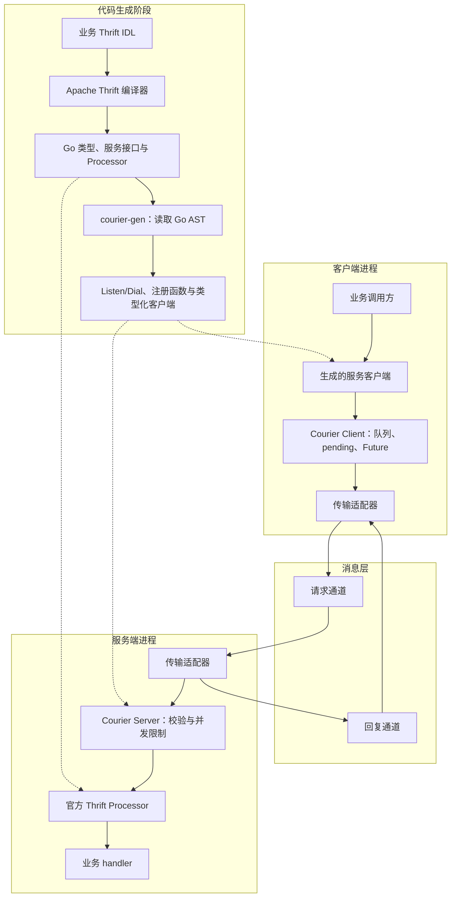

# 架构与传输语义

Courier 将 Thrift 的接口契约与消息传输分离：业务方法由官方 Processor 分派，框架负责请求路由、异步结果关联和资源约束，适配器负责具体消息系统的投递与故障处理。

## 架构图

图中的进程划分适用于 NATS 和 Kafka；内存适配器要求两端共用同一进程中的 `memory.Bus`。生成阶段只产出源代码，不启动服务；生成的 `Listen<Service>` 在运行时完成 Server 创建、handler 注册和 `Start`，`Dial<Service>` 创建专属核心连接并返回类型化客户端，二者不拥有应用传入的 Transport；多服务共享场景仍可显式注册与构造。

## 技术基础与模式对应

| 技术或模式 | 在本项目中的应用 | 实现入口 |
| --- | --- | --- |
| Thrift IDL、Binary Protocol、Processor | 定义契约，编码参数和结果，调用业务方法 | `codec.go`、`server.go`、`cmd/courier-gen` |
| Request-Reply（请求—回复） | 将一次 RPC 拆成请求消息与回复消息 | `client.go`、`server.go` |
| Correlation Identifier（关联标识） | 用 session 和请求 ID 找到在途调用，再校验服务与方法 | `client.go`、`envelope.go` |
| Return Address（返回地址） | 请求携带回复地址，服务端按原地址回复 | `transport.go`、各传输适配器 |
| 有界队列与固定 worker | 限制发送排队、在途状态和 handler 并发 | `client.go`、`server.go` |
| 连续完成前缀 | Kafka 允许并发处理，但仅提交前方全部完成的记录 | `transport/kafka/server.go` |

Thrift 的分层职责见 [官方 Concepts](https://thrift.apache.org/docs/concepts.html)；请求—回复及关联字段分别对应 Enterprise Integration Patterns 的 [Request-Reply](https://www.enterpriseintegrationpatterns.com/patterns/messaging/RequestReply.html) 和 [Correlation Identifier](https://www.enterpriseintegrationpatterns.com/patterns/messaging/CorrelationIdentifier.html)。各模式在 Courier 中的具体约束由上表所列源码实现。

## 消息格式与调用生命周期

外层使用 JSON envelope，包含协议版本、request/response 类型、服务名、方法名、随机 128 位 session 和请求 ID、绝对截止时间、回复地址与 Thrift binary payload；业务字段由 Thrift 编解码，`[]byte` payload 在 JSON 中占用 base64 空间。

1. 创建 Client 时先建立回复入口，再允许接收调用。
2. 生成客户端序列化参数，将调用交给核心的有界发送队列并取得 Future。
3. 固定发送 worker 发布请求；`Sent(ctx)` 等待适配器的发送确认。
4. 服务端校验 envelope 和 Thrift 消息，包括版本、头部一致性、尾随字节和截止时间，然后由 Processor 执行 handler。
5. 回复通过 session、请求 ID、服务和方法匹配 Future；调用完成、取消或超时均移除 pending 状态，迟到、未知及重复回复被忽略。

`Await(ctx)` 等待业务结果；单次等待 context 的取消不等于取消整个调用，调用 context 的取消也不保证撤销已经执行的远端操作。回复入口永久关闭时，客户端终止未完成调用；Future 不跨进程重启恢复。

序列化采用有界 transport，在写入过程中阻止超大载荷。编码和解码同时检查请求元数据是否留有错误回复预算；错误文本过长时保留错误码并缩短文本。此限制不能替代 Broker 的载荷上限配置。

## 错误、并发与资源所有权

| 情况 | 对调用方的表现 |
| --- | --- |
| IDL 声明的业务异常 | 生成的 Thrift 异常类型 |
| 未声明的业务异常 | Thrift application exception |
| 框架拒绝、协议错误或 handler panic | 框架错误；可通过 `RPCError` 检查 |
| 发布失败 | `TransportError` |
| context 取消或超时 | 支持 `errors.Is` 检查 context 错误 |

生成的 Courier 异步客户端及其同步便利方法可以共享；官方原生同步客户端保存最近响应元数据，共享该对象时需要应用处理并发访问。

先关闭 client/server，再关闭适配器和应用拥有的 SDK 连接。`Server.Close(ctx)` 先关闭各服务订阅，再取消共享处理 context；NATS 服务订阅会停止接收新请求，排空已接收请求并确认回复发布后返回。关闭期限到达会中止排空，直接取消 `Start` 的 context 或先关闭适配器／SDK 连接也会中断在途调用；Go 无法强制终止忽略 context 的 handler。客户端在途上限、发送队列和服务端并发限制只约束各自对象，不是整进程内存上限。

## 传输差异

| 传输 | 请求分配 | 回复入口 | `Sent` 的含义 | 主要边界 |
| --- | --- | --- | --- | --- |
| Memory | 同一服务的 worker 竞争同一个接收通道 | 进程内回复通道 | 本地有界发送队列接受 | 不持久化、不跨进程 |
| Core NATS | 服务 subject + queue group | 每个 Client 一个 Inbox 通配订阅 | 发布后 PING/PONG 往返 | 不使用 JetStream，无持久化确认 |
| Kafka | 每个服务请求 topic + consumer group | 每个 Client 一个直接分区 reader | Broker all-ISR 发布确认 | 可重投递，业务副作用可能重复 |

### Memory

适配器基于 [Watermill GoChannel](https://watermill.io/pubsubs/gochannel/)，每个逻辑服务只建立一个 GoChannel 订阅，所有副本竞争同一接收通道，避免每个副本收到广播副本；独立 Bus 互相隔离，最后一个服务订阅退出时关闭对应私有通道。

请求和回复使用不同 Watermill 实例，避免阻塞发布持有订阅读锁时与新订阅的写锁形成锁等待环。发布只从固定 worker 池发起，限制底层 SDK 创建发布协程的数量；handler worker 先确认接收，再执行业务并独立发布回复。

无服务返回 `ErrNoResponders`，队列满返回 `ErrOverloaded`；取消订阅或关闭时，已经进入发送队列的消息仍可能被丢弃。

### Core NATS

适配器基于 [Core NATS](https://docs.nats.io/learn/core-nats/) 的 subject、queue group 和 Inbox；每个服务使用独立 subject，同服务副本共享 queue group，配置前缀用于区分环境。服务名编码为 subject token，方法数量不增加订阅数量。

回复 subject 在 Inbox 后添加请求 ID。适配器使用有界 `ChanSubscribe` 保留 503 回复的 subject，按有界关联表处理 no-responders，并在调用结束时清理关联。Inbox 关闭会移除原生连接 CLOSED 通知。

服务订阅采用固定 worker 和 SDK pending 限制；慢消费者可能丢消息，调用最终超时，应通过应用配置的原生 `ErrorHandler` 观察慢消费者错误。Broker MaxPayload 必须与框架帧上限匹配。

断线发送失败；重连恢复订阅，不恢复已丢失的消息。示例通过 `ReconnectBufSize(-1)` 禁用重连发布缓冲；启用缓冲可能导致本地调用已超时后消息才被投递。关闭适配器不关闭应用拥有的 `*nats.Conn`，认证、TLS 和重连策略由应用配置。

### Kafka

适配器基于 [franz-go](https://github.com/twmb/franz-go)；请求由消费组分配，回复通过直接分区 reader 读取。每个独立服务预建请求 topic；共享物理 topic 的副本必须实现映射中的全部服务，`ServiceListener` 在启动前验证本进程的完整注册集合，不能验证其他进程的配置。

消费端关闭自动提交，以有界窗口记录每个分区按读取顺序的完成状态；只有成功回复或明确丢弃的连续前缀才能提交。回复发布或提交失败后停止接收新工作，有限排空后重新加入消费组，从已提交 offset 重读，因此不承诺业务恰好执行一次。

回复 reader 在接受调用前取得具体数字结束 offset，重连保留读取位置，保留期导致 offset 丢失时禁止自动 reset；新客户端生成新 session。多个 reader 可以看到共享分区的相同内容，session 过滤只保证路由关联，不提供保密隔离。

完整配置、毒消息策略和恢复行为见 [Kafka 路由与资源配置](KAFKA.md)，共享回复的带宽成本见 [容量规划](KAFKA-CAPACITY.md)，可复现验证与曲线见 [测试与性能](TESTING.md)。

## 调用 API 与默认限制

- `GetAsync` 成功：本地序列化完成并获准进入有界队列；并不表示远端执行成功。
- `future.Sent(ctx)`：达到当前适配器的发送保证。内存为本地有界发送队列接受；NATS 为发布后的 PING/PONG 往返，无持久化确认；Kafka 为 Broker all-ISR 发布确认。任何后端都不把发送确认当作业务完成。
- `future.Await(ctx)`：取得业务结果或异常。可多次、并发等待；返回的对象由调用者协调读写。
- 调用 context 控制调用生命周期；等待 context 只影响这一次等待。取消本地等待或调用均不保证撤销远端执行。服务端接收绝对截止时间，跨机器部署需要合理的时钟同步。
- 默认超时 30 秒、每个客户端最多 256 个在途调用、4 个发送工作协程；服务端默认同时执行 32 个 handler；默认封装帧上限 1 MiB。JSON 外层的 base64 和元数据会占用帧预算。
- 请求元数据必须为关联字段完整的错误回复留出空间，编码和解码均检查该预算；服务端不回传请求截止时间，错误文本超出回复预算时保留错误码并使用简短消息；Kafka 对无法满足该预算的入站记录按不可回复毒消息记录并丢弃，允许提交其 offset。
- 不自动重试业务方法，不承诺业务恰好执行一次。有副作用的业务方法需要应用提供幂等键。
- 先关闭 client/server，再关闭适配器和应用拥有的 SDK 连接。关闭 context 只限制等待时间；Go 无法强行终止忽略 context 的业务 handler。
