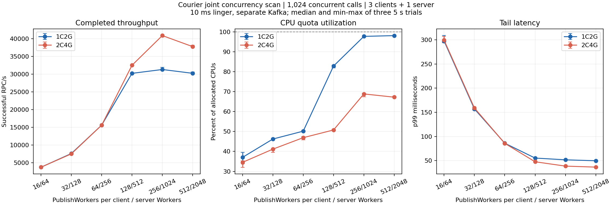
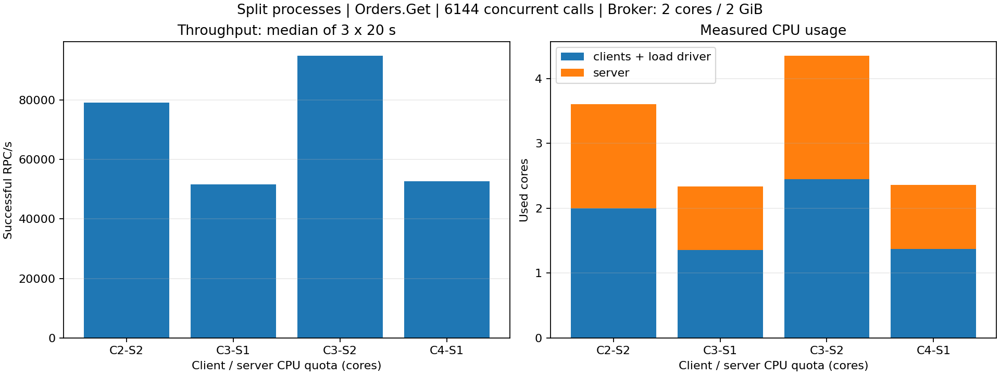
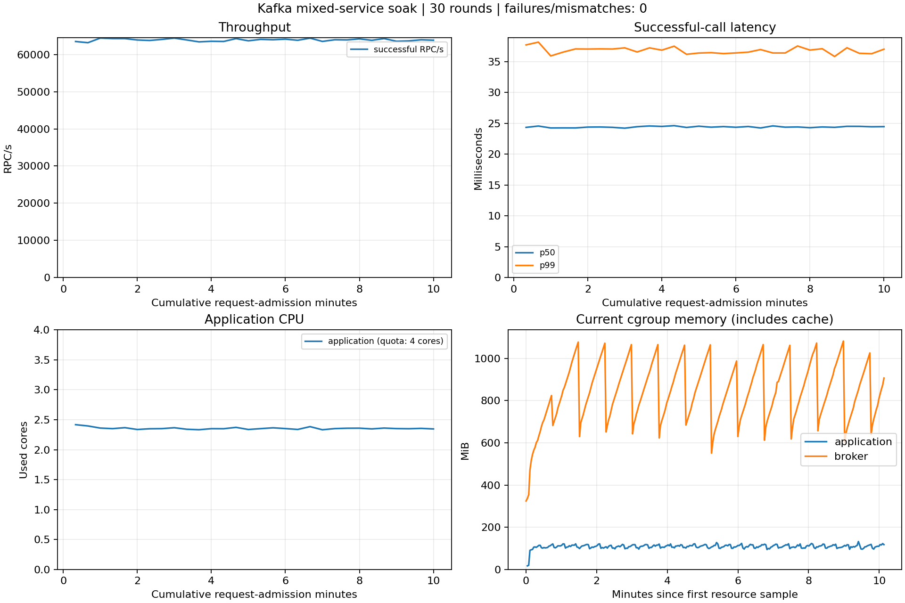

# Kafka 容量规划

## CPU 配额与并发配置

客户端 `PublishWorkers` 控制并发发送请求的协程数；Kafka 适配器的 `Workers` 控制每个请求 topic 的处理协程数，包括执行 handler 和等待回复发布确认，并非 Kafka Broker 的配置，也不是拉取线程数。两端都存在同步发布等待，默认 10 ms 攒批期间 worker 仍占用名额；增加名额可以提高批次利用率，直到 CPU、网络或下游成为新的瓶颈。

2026-11-02 在版本 `74671c0` 上测量，**三个客户端、一个服务端及测试驱动共享应用容器配额，Kafka 独立运行**；以下是小消息 `Orders.Get(id, 0)` 的起始配置，不是任意业务的默认值。

| 配置项 | 1C2G | 2C4G |
| --- | ---: | ---: |
| 每 Client `PublishWorkers` | 128 | 256 |
| 每 Client `MaxInFlight` | 512 | 1024 |
| 每 Client `DefaultTimeout` | 8 s | 8 s |
| Kafka 每请求 topic `Workers` | 512 | 1024 |
| Kafka `Window` | 1024 | 2048 |
| 每 transport `PublishBuffers` | 512 | 1024 |
| 核心 Server `MaxConcurrent` | 512 | 1024 |
| 应用 `GOMAXPROCS` | 1 | 2 |

配套提高窗口、缓冲与核心并发，避免只调整 worker 后被其他名额限制；默认处理与操作超时下，这两档自动计算的 `RebalanceTimeout` 均为 80 秒，需满足 Broker 消费组超时约束。

### 实测结果

每组连续三轮，每轮发起请求 20 秒后排空；吞吐、CPU、p99 为三轮中位数，内存为容器生命周期峰值。

| 应用配额 | 调用并发 | 成功 RPC/s | CPU 配额利用率 | p99 | 峰值内存 |
| --- | ---: | ---: | ---: | ---: | ---: |
| 1C2G | 1024 | 29,077 | 82.5% | 57.07 ms | 66.55 MiB |
| 2C4G | 1536 | 54,512 | 85.6% | 47.09 ms | 105.15 MiB |

全部调用成功且返回值匹配，无 OOM；1C2G 未发生 CPU 配额节流，2C4G 累计 4 个节流周期。CPU 以每轮 cgroup 使用量增量除以实际耗时及 CPU 配额计算，2C4G 的 85.6% 约等于 1.71 核，不能理解为 0.856 核。

短时扫描每档三轮、每轮 5 秒：1C2G 的最高中位数约 32,913 RPC/s（PublishWorkers=256、Workers=1024、调用并发 2048、CPU 99%、p99 99 ms）；2C4G 约 56,939 RPC/s（256/1024、调用并发 2048、CPU 94%、p99 58 ms）。继续增至 512/2048 后吞吐分别降至约 30,033/55,019 RPC/s，因此不建议单纯堆协程追求满核。



图中固定 1024 调用并发，点和误差线为三轮中位数及最小至最大值；2C4G 的最高吞吐来自 2048 并发，不在该图中。完整 [78 轮数据](benchmarks/kafka-cpu-capacity.csv) 共记录 13,033,590 次成功调用、0 失败或不匹配。Window、核心并发与缓冲随 worker 配套调整，这是联合配置扫描，不是单变量实验。

测量环境为 Apple M4 / OrbStack ARM64（虚拟机 8 vCPU、约 8 GiB，共享宿主机）、Go 1.27.3；应用分别限制 1 CPU/2 GiB、2 CPU/4 GiB，禁止额外 swap。Kafka 4.4.0 单节点独立容器限制 2 CPU/1 GiB，JVM 256–512 MiB，副本因子 1，无 TLS/SASL；请求 3 分区、回复 1 分区，经专用 Docker 网络通信。保留 10 ms linger、all-ISR 与幂等发布，无业务数据库或重计算，诊断 hooks 关闭。分三个阶段重建 Broker，阶段内顺序测试、未随机化；小幅差异可能受预热和共享宿主机波动影响。

### 4C4G 补测

2026-11-02，版本 `b990fa9`，应用容器配额改为 4 CPU/4 GiB、GOMAXPROCS=4；其余 Broker、宿主机、业务与三客户端/单服务端拓扑同上，Kafka 仍独立使用 2 CPU/1 GiB。三组配置每档三轮、每轮 5 秒；各 Client MaxInFlight=4096、超时 8 秒，Window=2×Workers、PublishBuffers=Workers、核心 MaxConcurrent=Workers，联合调整而非单变量实验。

| 每 Client PublishWorkers / 服务端 Workers | 调用并发 | RPC/s | CPU 配额利用率 | 成功调用 p99 ms | 失败数（三轮合计） |
| --- | ---: | ---: | ---: | ---: | ---: |
| 1024/4096 | 3072 | 79,779 | 88.2% | 61.76 | 0 |
| 1024/4096 | 6144 | 86,430 | 92.7% | 119.37 | 0 |
| 256/1024 | 1536 | 53,053 | 51.9% | 44.09 | 0 |
| 256/1024 | 3072 | 59,336 | 56.1% | 72.58 | 0 |
| 256/1024 | 6144 | 59,855 | 57.2% | 122.58 | 0 |
| 512/2048 | 1536 | 55,437 | 56.5% | 39.17 | 0 |
| 512/2048 | 3072 | 87,837 | 88.7% | 58.41 | 0 |
| 512/2048 | 6144 | 92,927 | 90.9% | 96.53 | 1536 |

表内吞吐、CPU 和成功调用 p99 为三轮中位数；含失败档位不能作为可靠容量，成功调用分位数也不包含失败请求的耗时。512/2048 在 6144 并发下第二轮发生 1536 次失败或结果不匹配，伴随服务 consumer 的回复发布/处理失败重入组日志，该轮成功调用 p99 达 5194 ms。

后续增加错误分类与 SDK 网络耗时采样，在同配置下复现到 1536 次客户端发布超时（TransportError 包装 context deadline exceeded），Broker Produce 响应等待约 5.1–5.5 秒，超过默认 5 秒 OperationTimeout；1536 对应 3 个客户端各 512 个正在发送的 worker。服务端回复发布也可能超时，随后消费组重入并重投递未提交记录。

在 Kafka 4.4.0 / JVM 25.0.4.1 / OrbStack ARM64 的 JFR 记录中，UnifiedLog.append 的一次锁等待为 5.122 秒，同期请求处理线程连续采样落在 OffsetIndex.append → ReentrantLock.unlock → LockSupport.unpark；GC 最大暂停约 16 ms，记录到的单次文件写入最大约 442 ms。这将阻塞位置定位到 Broker 日志追加/索引锁路径，不能据此断言 Kafka、JVM 或虚拟化层的具体底层缺陷，也不是 CPU 核数不足的证据。仅将测试 Broker 的 log.index.interval.bytes 从 4096 改为 1048576，三轮 20 秒对照仍出现 1024 次发布超时，未构成修复；正式配置、超时和自动档位保持不变。

**候选配置：每 Client PublishWorkers=512、MaxInFlight=4096；服务端 Workers=2048、Window=4096、核心 MaxConcurrent=2048；每 transport PublishBuffers=2048，调用超时 8 秒。** 在总调用并发 3072 下另做三轮、每轮 20 秒的延长验证，中位数 **89,082 RPC/s、CPU 84.0%（约 3.36 核）、p99 57.54 ms**，容器峰值内存 **189.68 MiB**，无失败、OOM 或 CPU 配额节流；这只是该负载下一分钟级验证，不覆盖更高并发或长时间运行。

同为 3072 并发，256/1024 约 59,336 RPC/s，512/2048 约 87,837 RPC/s，再翻倍到 1024/4096 反而约 79,779 RPC/s；因此四核可以利用起来，但增加协程并非总有收益，4 GiB 内存未用满也不意味着可以继续无界增大窗口。6144 并发已暴露失败，不将其峰值写作可用容量。

本轮共 27 轮测量，原始逐轮结果见 [4C4G 数据](benchmarks/kafka-cpu-capacity-4c.csv)。4 核档目前作为手动候选配置，`AutoCapacityProfile()` 仍最多选择 2 核档，尚未自动启用该候选值。

### 应用 2 GiB 与 Broker 内存对照

在 `9b00d60` 上保持 6144 调用并发和 512/2048 worker，应用改为 4 CPU/2 GiB，分别验证 Broker 2 CPU/1 GiB 与 2 CPU/2 GiB；每组运行三轮、每轮 20 秒，JVM 堆均为 Xms256m/Xmx512m，两组应用与 Broker 均禁止额外 swap。

| Broker 内存 | 成功 RPC/s 中位数 | p99 中位数 | 应用内存峰值 | Broker 采样 peak | 失败 |
| --- | ---: | ---: | ---: | ---: | ---: |
| 1 GiB | 95,109 | 100.879 ms | 238.62 MiB | 940.50 MiB | 0 |
| 2 GiB | 94,301 | 101.305 ms | 229.12 MiB | 1107.13 MiB | 0 |

应用 2 GiB 足以承载本次小消息负载，未触发预设的 1.8 GiB 停止阈值，未发生 OOM；Broker 数字为约 2 秒采样读取 memory.peak 的最大值。两组均未见 swap 使用和内存触限事件，但均有页回收活动，不能将零 OOM 当作完全没有内存压力。

Broker 增加到 2 GiB 提供了更多余量，但 1 GiB 对照组本轮也零失败，不能据此认定扩内存修复了先前停顿；历史失败测试的 Broker 允许额外 swap，本轮两组均禁用，不能将环境差异忽略。测试顺序为 1 GiB 后 2 GiB，均使用新建 Broker；分钟级结果不构成长期稳定性承诺，也不外推到大消息业务。

### 应用 1 GiB 与客户端／服务端分配

单方法短测进一步将应用改为 4 CPU / 1 GiB，Broker 保持 2 CPU / 2 GiB；6144 并发、三轮各 20 秒得到吞吐中位数 94,596 RPC/s、p99 中位数 100.575 ms，应用峰值 239.5 MiB，无调用失败或 OOM。减少内存配额只降低上限，不等于释放同样大小的实际占用。

随后将三个客户端及压测驱动放到一个进程／容器，服务端放到另一个进程／容器；客户端内存上限 768 MiB，服务端 256 MiB，各进程 GOMAXPROCS 固定为 4，单独改变 cgroup CPU 配额。Broker 独立保持 2 CPU / 2 GiB。

| 客户端／服务端 CPU 配额 | 成功 RPC/s | 客户端实际核数 | 服务端实际核数 | 客户端／服务端峰值 MiB | p99 ms |
| --- | ---: | ---: | ---: | ---: | ---: |
| 2／2 | 79,027 | 2.00 | 1.60 | 166／79 | 123.8 |
| 3／1 | 51,540 | 1.35 | 0.99 | 145／82 | 198.6 |
| 3／2 | 94,709 | 2.45 | 1.90 | 177／71 | 107.3 |
| 4／1 | 52,585 | 1.37 | 0.99 | 144／72 | 194.5 |



每组 6144 并发、三轮各 20 秒，调用均成功；吞吐、p99、客户端 CPU 是逐轮中位数，服务端 CPU 是负载期间采样计数的累计差值；峰值内存是容器生命周期采样峰值，见 [原始汇总](benchmarks/kafka-split.csv)。

服务端只有 1 核时约 60 秒内有 595–597 个 CPU 节流周期，增加客户端配额几乎无收益；两端各 2 核时客户端接近满额，增加客户端配额后吞吐提高。瓶颈取决于资源分配，不能只看总核数，也不能将含负载生成、校验、统计的客户端 CPU 全部归因于 SDK。拆分进程改变了调度、GC 和配额边界，与同进程曲线不是等价测量。

3／1、3／2 配额组日志出现回复生产缓冲满和消费重入，调用零失败不代表内部无重试；本次未将缓冲或超时改大以隐藏该现象。此表是单方法短时诊断，不是独立部署的长期容量保证。

### 启动时自动选择配置

`kafka.AutoCapacityProfile()` 读取当前 `runtime.GOMAXPROCS(0)`：1 选择 1 核档，2 及以上选择 2 核档，更高核数仍保留该保守档位，4 核手动候选值见上节补测；该入口显式启用，原有零值默认配置保持不变。它返回普通配置结构，调用方可在初始化前覆盖任意字段。

```go
profile := kafka.AutoCapacityProfile()
profile.Transport.Brokers = []string{"localhost:9092"}
profile.Transport.Prefix = "courier" // 与预先创建的 topic 保持一致
// 在此设置实际部署的 RequestTopics、ReplyTopic、TLSConfig、SASL 等。
transport, err := kafka.New(ctx, profile.Transport)
if err != nil {
    return err
}
// 服务端：demo.ListenOrders(ctx, transport, handler, profile.Server)
// 调用端：demo.DialOrders(ctx, transport, profile.Client)
// 按接入指南处理返回错误，并在退出时关闭 client/server 和 transport。
```

以上为配置接入片段，`demo`、`handler`、`ctx` 使用业务自己的生成代码、实现和生命周期上下文；完整创建、错误处理和关闭顺序见 [接入指南](GETTING-STARTED.md)。`transport`、`server`、`client` 仍由调用方负责关闭。客户端和服务端分别使用各自进程的配置，不会自动协调集群总并发。

该函数只在调用时采样，不监测负载、不修改已有对象，也不检查内存配额；调整容器 CPU 后，需在重新初始化时选择配置。`GOMAXPROCS` 表示 Go 的并行执行预算，不等同于物理核数或精确的 cgroup 配额：例如不足 1 核的容器不能视为已验证的 1 核环境；显式设置 `GOMAXPROCS` 时应与部署预算一致。启动时记录选择后的配置，便于排查。

这些档位尚未发布到 `v0.1.0`，使用该函数需引用包含它的后续提交或版本。

### 使用边界

- 三个客户端合计的发送名额为 3 × PublishWorkers；只有一个客户端或客户端/服务端分开配额时，不可直接照搬上述吞吐。
- 多服务会增加请求 topic worker 与缓冲总量；需要按整个进程核算，不能对每个服务重复承诺整机容量。
- 大消息会放大 MaxInFlight、Window 与 PublishBuffers 的内存占用；小消息峰值不证明 1 MiB 消息也可使用相同档位，内存不足时应降低这些值。
- 数据库连接池、下游限流和计算型 handler 可能要求更低的 MaxConcurrent；按业务容量覆盖档位，并复测 p99、错误率和资源峰值。
- 一分钟级闭环验证不代表长期稳定性或云 Kafka 的容量保证；调用并发不足时 CPU 不会用满，过量并发通常增加排队。

测试入口、参数及资源采样方法见 [测试与性能](TESTING.md)。

## 多服务持续负载与本机资源策略

2026-11-02 在应用 4 CPU / 1 GiB、Broker 2 CPU / 2 GiB 下，三个客户端对 Orders、Inventory 各两个实例持续混合调用四个方法；应用实例同处一个进程，1536 并发，30 轮各持续发起 20 秒，复用同一组连接、服务和 Broker，随后排空。

| 指标 | 实测值 |
| --- | ---: |
| 累计请求发起时间 | 600 s |
| 成功／失败或错配 | 38,400,978／0 |
| 吞吐中位数（轮次范围） | 63,944 RPC/s（63,196–64,442） |
| 每轮 p99 中位数／最大值 | 36.852／38.143 ms |
| 应用 CPU 中位数 | 2.35 核，约 58.8% 的 4 核配额 |
| 应用生命周期内存峰值 | 135.23 MiB |
| Broker 采样内存峰值 | 1086.14 MiB |
| 应用 CPU 节流周期／OOM | 0／0 |



四个方法分别完成约 960 万次调用，全部通过唯一业务标记检查；Count 使用压测专用回显实现，以区分等长请求。每轮结束 Pending 为零。284 次宿主机采样的内存压力均正常、swap 均为 0，未触发停止保护；测试结束已清理临时资源。

内存图展示 cgroup memory.current，包括缓存，并非 Java 堆或进程 RSS；Broker 占用周期性回落，不能仅从该图确定回收机制。该负载有 CPU 余量，不是吞吐极限测试；600 秒验证未复现历史停顿，不证明其根因已修复，也不外推到大消息、真实数据库或跨主机部署。

保留 [逐轮数据](benchmarks/kafka-soak.csv)、[资源时间序列](benchmarks/kafka-soak-memory.csv) 和 [环境与测试源码摘要](benchmarks/kafka-soak-environment.json)；复现及重绘方法见 [测试与性能](TESTING.md#多服务持续负载)。测试基于 `fd1690a` 的运行库，新增混合方法与轮数参数，不修改运行库默认值。

### 资源配置策略

本机测试环境为 Apple M4、16 GiB 内存，OrbStack 配置 8 vCPU / 8 GiB；容器配额不是独占物理资源，也不会在启动时预留全部配额。

1. 小消息混合调用先采用应用 4 CPU / 1 GiB、Broker 2 CPU / 2 GiB，串行执行测试，避免多组 Broker 与负载同时竞争宿主机资源；这不会修改其他容器或 OrbStack 全局配额。
2. Broker 堆保持 `-Xms256m -Xmx512m`，容器剩余空间留给堆外内存、线程栈与文件缓存；增加容器内存不等于必须同步增大 Java 堆。
3. 应用与 Broker 的 `--memory-swap` 设置为各自 `--memory` 值，禁止额外容器 swap；约每 2 秒记录宿主机内存压力和 swap，压力不为正常或 swap 开始使用即停止本轮，应用 memory.current 超过 0.85 GiB 也停止；硬限额不能保证宿主机永不缺内存，轮询也不能捕获所有短暂波动。
4. 稳态配置预留 CPU 和内存余量，不以满核为验收目标；先观察实际占用和节流，再调整出现瓶颈的一端。分进程的客户端 CPU 应扣清压测驱动的影响，不能直接外推到普通调用方。
5. 按整个进程核算 Workers、Window、MaxConcurrent 和缓冲：每服务、每实例都会增加资源总量；在真实消息大小、业务 handler、数据库连接池条件下重新测量，不照搬小消息结果。
6. 日志保留在原磁盘环境，不使用内存盘；OrbStack 数据镜像位于外置 SSD，存储尾延迟与宿主机资源竞争仍需同步观测。既往 Broker 停顿的底层原因未定，暂不能将加内存写成已验证修复。

以上是本机已测条件下的起始策略，不修改运行库默认值，也不提高 `AutoCapacityProfile()` 的两核档上限。

## 共享回复的读取成本

每个 `courier.Client` 创建一个独立 session 和直接分区 reader；它读取所选回复 partition 的全部消息，再按 session 过滤。若 partition p 每秒收到 Bp 字节、被 Cp 个 session 读取，所有 reader 的总载荷读取量约为 `Σ(Bp × Cp)`。

定义有效回复载荷速率为 `ΣBp`，则读取放大为 `A = Σ(Bp × Cp) / ΣBp`，其中 `Bp` 的单位为字节/秒，`Cp` 为该分区的 reader 数，假设所有 reader 均跟上读取。流量与客户端分布近似均匀，且每个活跃分区均有 reader 时，可近似为 `客户端数 / 活跃分区数`；不能直接除以配置分区总数，得到小于 1 的结果。

例如，3 个 Client 共享一个回复分区，该分区每秒产生 1 MiB 有效回复，则总 Value 读取量约 3 MiB/s，放大为 3 倍；这是计算示例，实测曲线见 [测试与性能](TESTING.md)。同一进程的多个服务客户端共享一个 `courier.Client` 可以减少 reader 数量。增加 partition 可分摊读取，但仍需考虑 Broker 带宽、连接数和客户端内存。

## 配置与监控

`MaxSubscriptions` 限制每个 transport 的订阅数量，它是资源上限，不是吞吐保证。请求 topic 的 `Workers`、`Window` 和处理超时决定并发及重平衡排空预算，详见 [Kafka 资源配置](KAFKA.md)。

使用 `Stats()` 中的 `ReplyBytes` 和 `ReplyMatchedBytes` 观察读取放大，同时监控消费延迟、进程 RSS、连接数和 Broker 带宽。字节计数只包含消息 Value，不包含 Kafka batch、压缩、协议、TCP 或 TLS 开销。不同权限域应使用不同回复 topic 和 ACL；session 过滤不提供内容保密。

## 负载测试

在专用 Kafka 环境运行共享回复读取测试：

```sh
KAFKA_BROKERS=127.0.0.1:9092 \
  go test -tags=integration -run '^TestKafkaSharedReplyReadAmplification$' -count=1 -v -timeout=180s ./examples/...
```

测试日志中的 `KAFKA_CAPACITY` 行包含 session 数、RPC 数、读取与匹配记录、载荷字节及完成时延；具体统计字段和场景见 `examples/kafka_capacity_test.go`。该测试的计时从发起首个调用前开始，不包含 Broker、transport 和 client 的初始化；64 次调用的短批次速率仍包含调度及缓冲冷启动影响，不能直接当作稳态吞吐上限。

部署容量应使用目标消息大小、并发数、Broker 拓扑和网络条件测量，关注持续负载及故障恢复期间的延迟和资源占用。

## 调整顺序

1. 确定目标成功调用速率、p95/p99 延迟和允许错误率，并固定典型请求/回复大小。
2. 先复用同进程的核心 Client，减少独立回复 reader；再评估增加回复分区，注意已有 session 不会自动迁移。
3. 按 handler 耗时配置 `Workers` 和 `Window`，同时核算重平衡排空预算；扩副本前确认请求分区数足以分配给副本。
4. 使用目标环境重复测量，观察是否出现吞吐趋平、尾延迟增长或错误率上升，再决定容量余量。

当前仓库提供闭环并发扫描，适合比较不同并发下的表现；闭环客户端在响应变慢时会减少发起速率，不能替代固定到达速率的过载测试或长时间稳定性测试。
