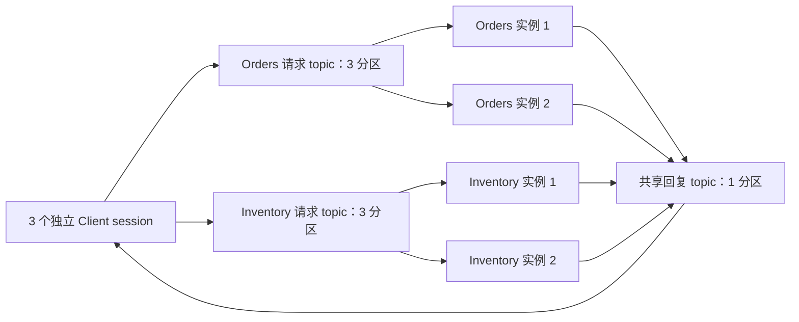
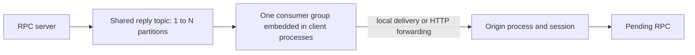

# Kafka 路由、资源与故障语义

实现使用 franz-go v1.22.2 和匹配的 kmsg v1.15.0；源码在 `transport/kafka`，部署工具在 `examples/brokeradmin`，集成测试位于 `examples/kafka*_test.go`。

首次运行请先完成 [Kafka 示例](EXAMPLES.md#kafka)；本文供部署与运维查阅，参数的容量选择依据见 [容量规划](KAFKA-CAPACITY.md)。

并发与阶段耗时数据见 [Kafka 网关并发测量](benchmarks/kafka-gateway-2026-11-09/README.md)，其中包含版本指纹和实现对照。

## 部署模型

客户端通过服务名调用，不指定服务实例；同服务的多个副本加入同一消费组，由 Kafka 分区分配决定接收请求的副本，分区内的 worker 可并发执行，因此不保证业务完成顺序。



图中独立 Transport 会各自读取回复分区；同一 Transport 内的 Client 共享分区 reader，由 reader 按 session 分发。请求消费组负责分工，回复 reader 不加入共同消费组。跨进程验证范围与运行命令见 [测试与性能](TESTING.md)。

部署顺序为：准备 Broker 及认证 → 创建请求/回复 topic → 配置一致的服务映射和回复分区 → 注册并启动服务端 → 创建客户端并调用；停止时先停止业务接入，再关闭 client/server、适配器，最后由运维决定是否关闭 Broker。

## Topic 与消费组

默认请求 topic 为 `<Prefix>.request.<注册服务名>`，默认回复 topic 为 `<Prefix>.replies`。所有方法都在消息中携带方法名，不按方法建 topic。

| 注册名 | 请求 topic | 请求消费组 | 副本必须实现 |
|---|---|---|---|
| Orders | courier.request.Orders | courier.servers.courier.request.Orders | Orders 的全部已注册方法 |
| Inventory | courier.request.Inventory | courier.servers.courier.request.Inventory | Inventory 的全部已注册方法 |

两个独立服务加一个共享回复域，共 **3 个业务 topic**。topic 数随独立服务部署单元和回复权限域增长，与方法数、调用数、客户端数无关。Kafka 内部 topic 不计入业务 topic 预算。topic 与 partition 的容量应按 Broker/controller 资源制定预算。

`RequestTopics map[string]string` 可以改变物理映射。若将 Orders 和 Inventory 都映射到 `commerce.requests`，每个消费副本必须同时注册这两个服务。适配器在 `Server.Start` 时检查完整注册集合，拒绝仅注册其中一项的副本。所有进程必须使用一致的映射与 Prefix；这不是跨进程配置一致性协议。默认每服务独立 topic 可避免把 A 请求竞争分配给只实现 B 的副本。更新方法也需要正常的兼容发布策略，旧副本收到新方法会返回 method_not_found。

运行时没有创建 topic 的入口。`examples/cmd/kafka-demo -mode provision` 是明确执行的部署动作，示例创建两个 3-partition 请求 topic 和一个 1-partition 回复 topic，副本因子 1 仅用于本地演示。生产 topic 的复制、保留、ACL 和 partition 预算由部署配置确定。

## 共享回复与准备顺序

1. 每个 `courier.Client` 生成独立随机 session，并从配置的 `ReplyPartitions` 选择一个 partition。
2. 原生 ListOffsets 查询该 partition 当前的具体结束 offset；首次注册时创建从该位置开始的直接 reader 并验证连接，后续注册复用 reader，但仍按各自注册时的结束 offset 过滤历史记录。
3. 每个请求记录原始回复 topic、partition、session 和 request ID；服务器按这些字段回复。
4. 每个 Transport 对每个回复 partition 只有一个 reader，不加入共享消费组；每条记录只解码一次，再按 session/route 分发给本 Transport 的对应 inbox，核心匹配 request ID、service、method。未知、迟到和重复回复不会匹配其他调用。

不能直接把各实例的 reader 放到同一个共享消费组，否则回复可能被没有对应等待状态的实例读走。多个生成的服务客户端可以共享一个 `courier.Client`；需要独立 Client 生命周期时，也应复用同一个 `*kafka.Transport`，这样同一回复分区仍只读取一次。不同 Transport 不会自动合并，以保持认证、连接、hook 和资源所有权边界。

```go
tr, err := kafka.New(ctx, opts)
if err != nil { return err }
// c1、c2 可以独立关闭；进程退出时再关闭 tr。
c1, err := courier.NewClient(ctx, tr, clientOptions)
if err != nil { _ = tr.Close(ctx); return err }
c2, err := courier.NewClient(ctx, tr, clientOptions)
if err != nil { _ = c1.Close(ctx); _ = tr.Close(ctx); return err }
```

关闭 Client 会注销对应 session 并等待其正在执行的回复回调结束，不影响其他 Client；同一 Transport 不允许重复注册活跃 session。reader 在最后一个 Client 关闭后仍保留到 Transport.Close，数量受配置的回复分区数量限制。回复回调应快速返回，避免阻塞同分区其他会话；核心 Client 的回调负责关联结果，不执行用户业务处理。

复用 Transport 也会复用生产者：`PublishBuffers`、`MaxSubscriptions` 等是整个 Transport 的总预算，不是每个 Client 的预算；从多个 Transport 合并时，应按总并发配置容量并保留过载保护，不能期待原来每个 Transport 的缓冲自动累加。

跨进程隔离可静态指定实例 A/B/C 的 `ReplyPartitions` 分别为 `[0]`、`[1]`、`[2]`，并预建相应分区；服务端允许列表配置为 `[0,1,2]`。部署方须保证分区归属不重复，本适配器不提供租约或自动独占分配；仅把所有客户端都配置成 `[0,1,2]` 并不能保证无碰撞。session 过滤仍保留，用于拒绝分区复用后迟到的旧回复。

扩容时保留原 partition，先让服务端允许新增 partition，再让新客户端选择新增 partition。已存在客户端及在途请求保留原地址。不同权限域使用不同的回复 topic/ACL；session 过滤不是数据保密机制，同 partition 的其他 reader 能读取消息内容。

## 确认、重投递与提交

`GetAsync` 返回表示本地接受；`Sent` 表示 Kafka all-ISR 发布确认；`Await` 表示业务结果。all-ISR 的实际容灾能力取决于 Broker 的复制与 min.insync.replicas 配置。原生 producer 的幂等性不等于 handler 恰好执行一次。

每个请求 topic 使用一个独立 group consumer。关闭自动提交；固定数量 worker 处理有界 window。每个 partition 按读取顺序维护未完成记录，只有已成功回复或按下述策略丢弃的连续前缀才可提交。前面的请求未完成或回复失败，即使后面的请求已返回，也不能跳过前面的 offset。控制记录造成的 offset 数值空洞不会被误判为丢失记录。

回复发布或提交失败后停止读取新工作，排空当前窗口，关闭并以退避方式重新加入消费组，从 Broker 已提交位置重读。如果副作用已执行而回复发布失败，重投递会再次执行 handler，业务需要用幂等键避免重复副作用。核心不自动重新创建或重试业务调用。

服务端在执行 handler 前检查请求绝对截止时间。过期重投递返回 deadline 错误，不再次执行 handler。取消本地调用不保证撤销远端执行。服务关闭时允许已经生成的回复在有限时间内完成发布，再提交安全前缀；先关 server/client，再关 transport。

没有有效回复路由、错误服务或无法解码的消息会记录 topic/partition/offset、增加 `DiscardedRecords`，然后丢弃并提交，以免毒消息永久堵塞分区。有效路由内的 Thrift 协议错误由核心返回错误。不会自动建立 DLQ。

入站元数据必须为错误回复预留帧预算，否则同样视为不可回复毒消息；handler 返回 `ErrTooLarge`（包括核心帧上限小于适配器）或原始回复超过适配器上限也属于永久大小错误，会记录并丢弃，允许提交，客户端可能等待至超时；这些情况不会靠重投递恢复，其他处理错误和回复发布失败仍保留原重试策略。

## 资源预算

| 配置 | 默认 | 范围与含义 |
|---|---:|---|
| 核心 Client MaxInFlight / PublishWorkers | 256 / 4 | 每个 core client 的在途数 / 固定发送 worker |
| 核心 Server MaxConcurrent | 32 | 每个 server 的 handler 并发；超额返回 overloaded |
| Workers / Window | 16 / 64 | 每个本地请求 topic 订阅的 worker 数 / 未提交工作数，不是全消费组总额 |
| PublishBuffers | 256 | 每个 transport 的原生 producer 缓冲记录数；满则 ErrOverloaded |
| MaxFrameBytes | 1 MiB | 包含外层二进制信封；适配器配置允许 512 B–16 MiB |
| MaxTopics | 128 | 每个 transport 的有界 topic metadata 项数，包含回复 topic |
| MaxTopicPartitions | 64 | metadata 检查时允许的每 topic partition 数 |
| MaxSubscriptions | 128 | 每个 transport 的 inbox + 请求 topic 订阅数 |
| MetadataMinAge | 250 ms | Leader 错误等情况下 metadata 刷新的最小间隔，可通过适配器 Options 调整 |
| OperationTimeout / ProcessingTimeout | 5 s / 30 s | 发布、提交等操作 / 单个 handler 的期限 |
| StartupTimeout | 15 s | 启动连接、reader、消费组准备的等待上限 |
| RebalanceTimeout | 默认 150 s | 自动按整个 Window 的 worker 批数计算，见下式 |

多个进程或多个 transport 订阅同一请求 topic 时，各自分配 worker 与 window；计算整机预算时需要累加，增加 Broker 分区不会自动增加这些本地名额。

重平衡预算必须严格大于 `ceil(Window/Workers) × (ProcessingTimeout + OperationTimeout) + OperationTimeout`，默认再加 5 秒余量。该预算覆盖排队的所有 handler 批次、回复确认和最终提交。部署必须将该预算与 Broker group/max-poll 策略匹配；缩小 window 和单次处理期限可缩短排空时间。忽略 context 的业务 handler 无法被 Go 强制终止，可能妨碍关闭与重平衡；Close 的 context 仅限制调用方等待。

SDK 同时限制缓冲字节、单连接读取 32 MiB、单次 fetch 数量及解压批次大小；fetch 字节目标最多 24 MiB，Kafka 为读取首个大批次可能超过 fetch 目标，仍受读取/解压上限约束。这些是局部资源上限，不是整进程 RSS 保证。各 reader、topic consumer 和 transport 会分别持有 SDK 连接/缓冲，部署应限制总实例数。metadata 缓存 30 秒；外部扩容的预算检查可能在刷新时才反映，不能用它替代 Broker 侧预算治理。

## 断线与保留时间

回复 reader 重连沿用原 offset，不重新跳到末尾。超出保留范围时禁止自动 reset，reader 失败会终止本客户端的未完成调用；应用需要建立新客户端。客户端进程重启产生新 session，既有 Future 不恢复。请求消费组从已提交位置继续；Broker 保留时间必须覆盖期望排队/离线窗口，已被清理的请求无法恢复。请求与回复 topic 都不能随意删除重建并期待在途调用继续。

`TLSConfig`、`SASL`、`Dialer`、`Hooks` 复用原生 SDK 类型；不开放能覆盖消费组、partition、自动建 topic 等约束的任意 `kgo.Opt`。连接参数应与目标 Broker 的认证和加密配置一致。

`Stats()` 暴露读到/匹配的回复记录和载荷字节、处理/发送/提交数、丢弃数、重启和分配/撤销次数。匹配数可能包含重复回复，不等于唯一业务完成数。读取放大与监控建议见 [容量规划](KAFKA-CAPACITY.md)。

## 故障定位

| 现象 | 优先检查 | 处理方式 |
| --- | --- | --- |
| 启动失败 | topic 是否存在、分区列表、ACL、Broker 地址、完整服务注册 | 修正部署配置后重建对应对象 |
| `Sent` 失败 | Broker 可用性、发布权限、帧大小、producer 缓冲 | 按错误原因恢复；未知投递结果下重试须考虑幂等 |
| `Sent` 成功但 `Await` 超时 | 服务消费延迟、handler 耗时、回复发布与读取链路 | 结合服务日志和 `Stats()` 定位，勿将发送确认视为业务完成 |
| 重复副作用 | 处理后回复失败、提交失败或重平衡 | 在业务存储层使用幂等键和原子写入 |
| `DiscardedRecords` 增长 | 日志中的 topic/partition/offset 与丢弃原因 | 修复非法路由、协议或超大帧；系统不自动建立 DLQ |
| 回复 reader 永久失败 | 保留时间导致 offset 丢失、topic 被删除重建 | 排除原因后创建新 Client，旧 Future 不恢复 |

Kafka 日志、消费位置与投递保证的基础见 [Apache Kafka Design](https://kafka.apache.org/41/design/design/)；本适配器的提交策略以本文和 `transport/kafka/server.go` 为准，不提供跨业务存储与消息提交的原子事务。

## Leader 变化与 metadata 刷新

`Options.MetadataMinAge` 默认 250 ms，最小值 10 ms，控制原生客户端 metadata 刷新的节流间隔，适用于调用端和服务端应用内的 producer、请求 consumer 及回复 reader，不修改 Kafka Broker 配置；它不是固定轮询周期，也不是故障恢复时间保证，不改变 producer 的攒批设置。间隔较大可减少错误期间的 metadata 请求，但可能延长新分区就绪或 Leader 切换后的恢复，配置时应留足调用期限和发送操作期限。

Metadata 已报告 Leader 不代表该分区立即可接受 Produce；新建 topic 或 Leader 切换期间仍可能短暂返回 `NOT_LEADER_FOR_PARTITION`，SDK 在刷新 metadata 后重试发布，幂等 producer 保持启用。该机制只处理发布层重试，不提供业务副作用的恰好一次保证。

## 按 CPU 选择启动配置

小消息吞吐场景可显式使用 `AutoCapacityProfile()`，在初始化前统一选择客户端发送、服务端处理、窗口和缓冲配置；1 核与 2 核的实测值、使用示例及适用边界见 [容量规划](KAFKA-CAPACITY.md#启动时自动选择配置)。原有默认值不变，不提供运行中的自动扩缩容。

## Embedded reply routing

`Options.ReplyRouter` enables consumer-group reply routing without a registry or
an additional broker. All client transports for a routed reply topic must use
one group. Use a **separate reply topic** from legacy
manual-partition inboxes: mixing the two modes can discard unroutable replies or
restore read amplification. Existing direct-reader behavior remains the default.

```go
opts.DynamicReplyPartitions = true // also set on server-only transports
opts.ReplyRouter = &kafka.ReplyRouterOptions{
    ListenAddress: "0.0.0.0:8443",
    AdvertiseURL:  "https://instance-specific-host:8443",
    Group:         "courier-reply-router",
    ServerTLS:     serverTLS,    // certificate for this instance-specific hostname
    ClientTLS:     clientTLS,    // trust configuration for peer certificates
}
```

Each advertised endpoint must identify one directly reachable instance, not a
load-balanced service address. `AllowInsecureHTTP` explicitly permits HTTP for
trusted private networks/tests. This router targets trusted enterprise-internal
services and does not authenticate routing metadata or forwarding bodies with HMAC.
Kafka writers, router endpoints and participating services must belong to that
trusted deployment. TLS configuration remains available for the HTTP path;
removing HMAC does not enable TLS/mTLS on the experimental Thrift TCP adapter.
Redirects and environment HTTP proxies are not used. Port zero is supported for
local tests; `ReplyEndpoint()` returns the selected endpoint. Server-only
transports do not need a listener: leave `ReplyRouter` nil and enable
`DynamicReplyPartitions`. `ReplyRouterOptions.Secret` has been removed.

Binary reply routing metadata uses format version 1.



Requests carry signed routing metadata in Kafka headers, including an instance
nonce, session, request ID, partition, and expiry. The Kafka server adapter copies
this metadata to the response; upgrade that adapter too. The consumer validates
metadata, delivers locally or forwards over reused HTTP connections, and commits
only contiguous completed offsets. Replies are acknowledged after the target
callback returns, not merely after queuing a network write. The core Client
removes completed pending calls; the router additionally suppresses the last
`DedupEntries` IDs per inbox (default 4096). This bounded cache is not durable
exactly-once delivery: replay outside the cache is possible, and a restarted
origin has already lost its pending calls.

A restarted process receives a fresh nonce even if its address/session is reused.
It rejects old-instance deliveries; forwarding peers cache that terminal result
in a bounded cache. Missing sessions and expired replies are terminal too.
Unreachable peers and transient HTTP failures retry until the signed deadline,
bounded by `MaxReplyAge` (default 30s, at most `ProcessingTimeout`). A forwarding
process stopping before delivery completes leaves the offset uncommitted for
another group member. Expiry is deliberately terminal and permits the offset to
advance; it does not report successful delivery to the RPC caller.

The existing `Workers` and `Window` bound concurrent forwarding and fetched
records. HTTP handlers also bound concurrent deliveries. Dedup caches are bounded
per inbox, idle pooled connections are bounded globally, and stale-instance
entries are bounded to 1024. A slow/unreachable destination can still delay a
partition's contiguous commit and fill the shared window, delaying other assigned
partitions until expiry. Choose deadlines
and limits for the workload; the first implementation does not batch HTTP replies.
Callbacks must remain short and must not synchronously close their own inbox.

In routed mode new requests hash their request ID over live partition metadata,
refreshed every second; existing requests retain their original reply partition.
Consumers subscribe by topic, discover added partitions and rebalance, starting
uncommitted partitions at the beginning so discovery does not skip new replies.
`MaxTopicPartitions` still bounds accepted growth. Expansion is eventual, not an
instant cutover; producer metadata convergence can cause a bounded retry and
request re-execution, consistent with the existing at-least-once server contract.
Kafka topic provisioning/partition increases remain deployment operations.

For graceful process shutdown call `Client.Drain(ctx)` on every owned client
before `Transport.Close(ctx)`. Drain rejects new calls and waits for admitted
calls; its deadline aborts remaining calls. Keep the transport and forwarding
endpoint running until draining completes. Unexpected process death cannot
recover the origin's in-memory pending calls. Business retries still require
idempotency.

`Stats().ReplyRecords` counts Kafka reads at the group consumer, while
`ReplyMatched` counts deliveries at the destination. `RouterStats()` exposes
completed forwards, expired replies, suppressed duplicates, stale-instance
replies and retries. Sum across processes to assess read amplification; recovery
replays can legitimately exceed one read per reply. Throughput, CPU and memory
benefits depend on whether avoided reads outweigh forwarding costs.
# Ready-only reply forwarding batches

`ReplyRouterOptions.BatchSize` optionally enables forwarding batches (2–32;
zero keeps single-reply HTTP requests). Enable it only after all receiving peers
support `/courier/replies`; there is no automatic fallback to an older receiver.
Setting it back to zero restores single-reply forwarding without changing topics.

The first ready reply starts immediately. Replies queued for the same endpoint
while a request is in flight are sent together next, without a batching timer.
Each endpoint has one active sender; consumer workers bound queued messages.
A batch is limited by both message count and the aggregate frame-byte budget.
Slow destinations can still occupy the shared consumer window; this option does
not provide per-destination fairness.

The receiver returns a status for every reply. Successful deliveries, stale
instances, expiry and malformed messages retain the single-reply semantics;
network failures retry within each reply's lifetime. A lost batch response may
cause replay, so inbox deduplication remains necessary. The existing contiguous
completion window controls Kafka commits; sending a batch is not itself an ACK.
`RouterStats.HTTPRequests` and `HTTPMessages` count remote attempts, including
retries, and expose the observed messages-per-request ratio.


### Bounded overlapping reply batches

For a dedicated client transport, the tested high-throughput configuration uses
`Options.Workers = 128` and `ReplyRouterOptions{BatchSize: 32, BatchConcurrency: 2}`.
Keep server-side worker tuning independent. `BatchConcurrency` accepts 0/1 for
serial sending (default) or 2 for at most two batches in flight per endpoint.
It applies only when BatchSize > 1.

One coordinator removes messages from each endpoint queue. A second send starts
only when at least BatchSize items are waiting; byte limits and cancellation can
reduce the actual batch. With no active send, a partial batch starts immediately.
Results may arrive out of order and are returned through each item's own done
channel; the existing contiguous completion window still controls Kafka commits.
The coordinator remains tracked until all sends finish, including cancelled
waiters. No linger timer or unbounded send queue is introduced.
