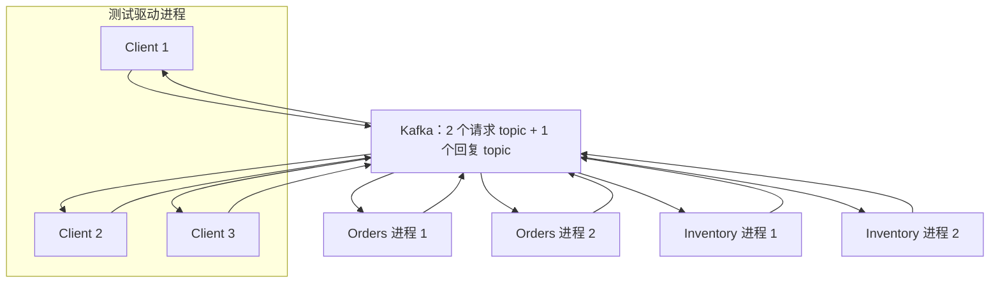
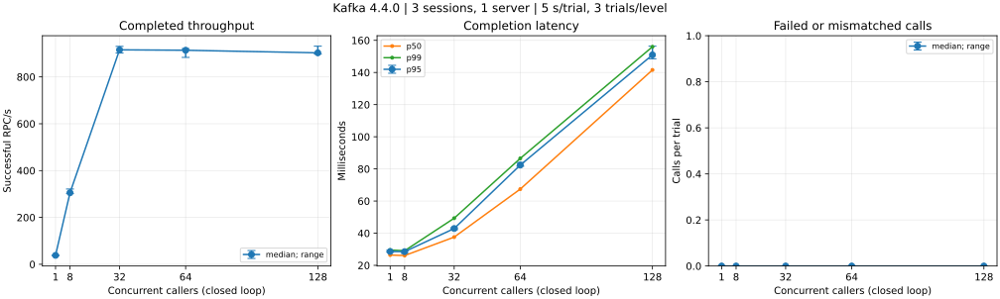
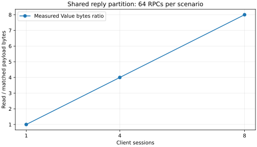

# 测试与性能

本文区分功能正确性、短时闭环压测和容量模型；曲线展示指定环境中的观测，不是吞吐上限或生产服务等级承诺。

## 测试分层

| 层次 | 检查对象 | 入口与环境 |
| --- | --- | --- |
| 普通测试 | 请求关联、重复回复、取消、超限、生成器、内存调用与资源关闭 | 各模块 `*_test.go`，无需 Broker |
| Broker 集成测试 | NATS/Kafka 的路由、恢复、提交与真实传输行为 | `examples`，`integration` 标签及对应 Broker |
| 跨进程拓扑 | 2 个服务、每服务 2 个进程实例、3 个 Client 的返回值归属 | `TestKafkaCrossProcess`，真实 Kafka |
| 读取放大 | 1/4/8 个 session 读取一个共享回复分区的字节开销 | `TestKafkaSharedReplyReadAmplification` |
| 并发扫描 | 不同并发下的成功速率、完成延迟及失败数 | `TestKafkaLoadCurve` |

### 跨进程拓扑



测试共发起 240 次调用，每个 Client 对 4 个方法各调用 20 次，校验业务结果、响应所属服务、每个服务的两个实例均被使用，以及结束后 pending 为 0；Get/Reserve 返回的 PID 用于统计实例分布，List/Count 不返回 PID。3 个 Client 是同一测试进程中的独立对象，4 个服务实例为独立进程；测试不承诺每个 Client 每次都能均匀命中所有实例。

## 性能测量方法

闭环扫描使用 1 个 Orders 服务实例、3 个 Client session、3 个请求分区和 1 个回复分区，测量 `Orders.Get(id, 0)`，返回 ID、来源和三个整数；它与上述四服务进程的正确性测试是不同场景。

- 并发档位为 1、8、32、64、128，每档顺序运行 3 次，每次持续发起请求 5 秒，然后等待在途调用结束。
- 每个并发 worker 在上次调用完成后才发起下一次调用，按 worker 编号分配至三个 Client；并发为 1 时仅一个 Client 发起流量，三个回复 reader 均存在。
- 初始化 Broker/适配器和每个 Client 的一次预热调用不计时；成功 RPC/s 为成功数除以实测时间，时间包含末尾排空。
- 延迟从调用同步便利方法前开始，到结果返回结束，包含本地排队、发布、服务执行和回复读取；p50/p95/p99 按成功样本排序后的 `floor((N-1) × p)` 索引计算。
- 返回错误、空结果或 ID/来源不匹配均计为失败；每轮完成后校验无 pending 遗留。
- 服务端 MaxConcurrent=128；Kafka Workers=16、Window=64；每 Client MaxInFlight=512、超时 8 秒，其余为适配器默认值。

闭环负载会在响应变慢时自动降低发起速率，因此曲线不描述固定到达速率下的过载积压；本场景也未覆盖大消息、业务数据库耗时、多 Broker 容灾或长时间稳定性。

## 实测曲线

以下曲线是 2026-11-01 的历史基线，代码基线为 `f889f3fa0952ff04a0c268daa2cccbafc0953302`，测试源码摘要见[测量元数据](benchmarks/environment.json)。测量使用 franz-go v1.22.2，metadata 刷新节流为 5 s，producer linger（攒批等待）为 10 ms。

当前版本的 metadata 刷新节流默认为 250 ms，测试源码也已有变更；这些曲线不代表当前主分支的重新测量结果，当前配置和故障恢复验证见 [Kafka 手册](KAFKA.md)及下文。

测量环境：Apple M4、10 核、16 GiB 内存；Go 1.27.3 darwin/arm64；Kafka 4.4.0 单节点 KRaft，运行于 OrbStack ARM64 虚拟机（8 vCPU、约 8 GiB），容器内存上限 1 GiB、JVM heap 256–512 MiB，副本因子 1，客户端通过本机映射端口访问，无 TLS/SASL；机器同时运行其他常驻容器，未隔离 CPU。



本次 15 轮扫描共完成 **46,877 次成功调用，失败或结果不匹配为 0**；下表为每档三轮的中位数：

| 并发 worker | 成功 RPC/s | p95（ms） | p99（ms） |
| --- | ---: | ---: | ---: |
| 1 | 38.14 | 28.60 | 29.52 |
| 8 | 305.32 | 28.52 | 29.09 |
| 32 | 915.57 | 42.92 | 49.34 |
| 64 | 913.74 | 82.40 | 86.56 |
| 128 | 902.67 | 150.96 | 156.01 |

在这组环境和小载荷下，并发达到 32 后吞吐接近平台，而尾延迟继续增长；这说明继续增加调用并发没有带来相应吞吐收益，具体瓶颈仍需剖析，不能据此推导其他部署的容量。

横轴为同时发起调用的 worker 数；曲线为各档 3 次测量的中位数，吞吐、p95 和失败数的误差线为最小至最大值，p50/p99 仅画中位数；相邻点连线只帮助阅读，不表示未测量档位的预测。



读取放大图来自每档 64 次调用的独立短批次实验，1/4/8 个 reader 读取同一回复分区；该图的横轴是 session 数，不是并发 worker 数，字节数仅包含 Kafka Value。

原始逐轮数据见 [并发扫描 CSV](benchmarks/kafka-load.csv) 和 [读取放大 CSV](benchmarks/kafka-capacity.csv)，环境与测试源码标识见 [测量元数据](benchmarks/environment.json)。

## 复现

从仓库根目录运行普通测试：

```sh
CGO_ENABLED=0 go test ./... ./transport/memory/... ./transport/nats/... ./transport/kafka/... ./examples/...
CGO_ENABLED=0 go vet ./... ./transport/memory/... ./transport/nats/... ./transport/kafka/... ./examples/...
go test -race ./... ./transport/memory/... ./transport/nats/... ./transport/kafka/... ./examples/...
```

真实 Kafka 测试需要可访问的专用 Broker，以及创建/删除测试 topic 的权限；下面地址适用于 Broker 本机监听 9092 的环境，若部署不同，设置 `KAFKA_BROKERS` 为实际地址，测试会创建带唯一前缀的 topic 并在正常结束时删除：

```sh
KAFKA_BROKERS=127.0.0.1:9092 CGO_ENABLED=0 \
  go test -tags=integration \
  -run '^TestKafka(LoadCurve|SharedReplyReadAmplification|CrossProcess)$' \
  -count=1 -v -timeout=240s ./examples/... > kafka-results.log 2>&1
```

确认命令成功且日志末尾为 `PASS` 后生成图表；Python 只用于绘图，不是框架运行依赖：

```sh
python3 -m venv .chart-venv
.chart-venv/bin/pip install matplotlib==3.9.4
.chart-venv/bin/python scripts/plot-kafka.py kafka-results.log
rm -rf .chart-venv
```

绘图脚本输出两个 SVG 和两个 CSV，重新测量后应同时更新环境元数据；原始日志保留作测量依据，审查完成后可删除。进程被强制终止时测试清理可能未执行，应按日志和本次测试前缀核对遗留 topic，不删除其他任务资源。

## 诊断与结果解读

吞吐趋平同时尾延迟上升通常表示某处排队增加，需要结合客户端、服务端和 Broker 指标定位，不能仅凭曲线认定瓶颈；错误率不为零时必须同时报告错误类别，不能只展示成功吞吐。

`TestKafkaSharedReplyReadAmplification` 使用确切的读取/匹配记录数断言校验共享回复行为；`TestKafkaLoadCurve` 校验返回值和 pending 清理，但不设置固定性能阈值，以免把单机调度波动当作功能回归。容量估算见 [Kafka 容量规划](KAFKA-CAPACITY.md)，传输故障排查见 [Kafka 路由与资源配置](KAFKA.md)。

## 完整 Broker 回归

从仓库根目录运行，使用专用测试 Broker；Kafka 测试需要创建及删除 topic 的权限，`NATS_SERVER` 用于启动、停止和重启故障测试专用进程。

```sh
NATS_URL=nats://127.0.0.1:4222 NATS_SERVER="$(command -v nats-server)" \
  go test -tags=integration -run TestNATS -timeout=300s ./examples/...

KAFKA_BROKERS=127.0.0.1:9092 \
  go test -tags=integration -run TestKafka -timeout=600s ./examples/...
```

先运行 `command -v nats-server` 确认可执行文件已加入 PATH；也可将 `NATS_SERVER` 设为已安装的绝对路径；普通测试无需 Broker，race 检查需要启用 CGO。上述 `-timeout` 限制整个测试包的执行时间，不改变单次调用和故障恢复的断言期限。

## 扩缩容、背压与进程故障

`examples/high_availability_test.go` 使用真实 Broker 和独立服务／客户端进程；子进程通过握手报告就绪，故障注入使用 `Process.Kill`，不执行正常关闭流程。

| 场景 | 验证内容 |
| --- | --- |
| Kafka / NATS 动态扩缩容 | 4 个持续调用者下执行两轮 1 → 2 → 1；确认新实例参与、退出后仍可调用、结果匹配，正常扩缩容不重复执行 |
| Kafka / NATS 有界背压 | 3 轮各 256 次突发调用，客户端在途上限为 8；检查拒绝、已接收调用完成、pending 排空与后续调用恢复 |
| Kafka 发送端背压 | 切断真实 TCP 链路、限制原生发送缓冲；恢复网络后在 10 秒内重新调用成功，记录缓冲仍满时的拒绝次数 |
| 服务端强杀 | 在业务执行前及业务执行后、回复前分别终止进程；Kafka 验证重投及重复副作用窗口，NATS 验证旧调用超时和新调用恢复 |
| 客户端强杀 | handler 执行中终止客户端，创建新客户端后释放旧回复；校验新调用不串消息，Kafka 另核对读取数与匹配数 |
| 既有故障回归 | Kafka 回复发布失败、提交顺序、回复 reader 重连、过期重投；NATS Broker 强杀重启 |

从仓库根目录运行，先配置专用 Kafka、NATS Broker 及 `NATS_SERVER` 可执行文件路径：

```sh
KAFKA_BROKERS=127.0.0.1:9092 NATS_URL=nats://127.0.0.1:4222 \
NATS_SERVER="$(command -v nats-server)" \
  go test -race -tags=integration \
  -run '^Test((Kafka|NATS)HA.*|Kafka(LeaderMetadataRecovery|CommitOrderAndRebalance|ProducerBackpressure|ResponseFailureRedeliveryAndCommit|ReplyReconnectRetainsOffset|ExpiredRedeliveryDoesNotRepeatHandler)|NATSDisconnectReconnect|NATSDrainClose)$' \
  -count=1 -v -timeout=300s ./examples/...
```

日志记录调用结果、恢复耗时、重复副作用和 pending；背压测试的 heap 与 goroutine 数是阶段采样，不是峰值，也不构成长时间无泄漏证明。Kafka 的回复发布失败或服务端崩溃可能重执行业务，因此重试有副作用的方法需要业务幂等；NATS 不持久化重投已交付请求。

`TestNATSDrainClose` 另外覆盖超过 worker 数量的待处理请求排空和关闭期限到达后的中止行为；正常缩容应先调用 `Server.Close` 并等其成功，再关闭适配器和 SDK 连接，提前取消启动 context 不属于正常排空路径。

这些测试覆盖应用进程的可用性及单 Broker 故障行为，不验证多 Broker 集群选主、跨可用区故障或长时间稳定性；恢复时间取决于 Broker、客户端超时配置及部署环境，测试耗时不是服务等级承诺。

`TestKafkaLeaderMetadataRecovery` 通过 TCP 转发真实 Kafka 流量，并将一次成功的 Produce 确认替换为 `NOT_LEADER_FOR_PARTITION`：5 秒 metadata 节流配置应无法在 2 秒内完成发送确认，默认配置应恢复，并验证重试没有产生第二条业务执行；Broker 已保存首条记录，因此该测试也覆盖确认丢失后的幂等发布。
