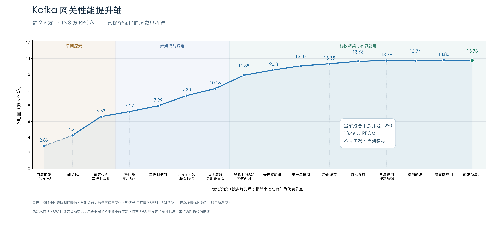
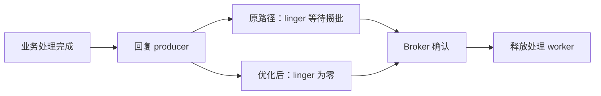
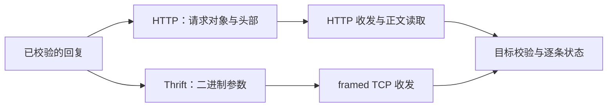
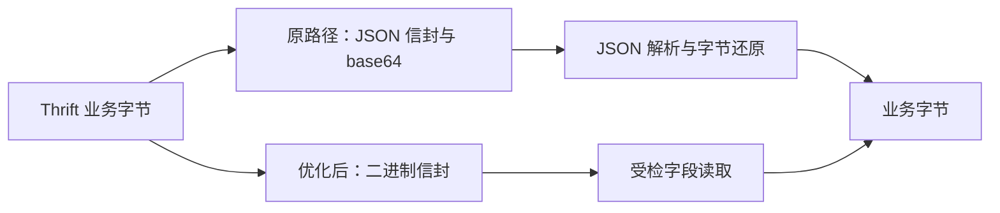
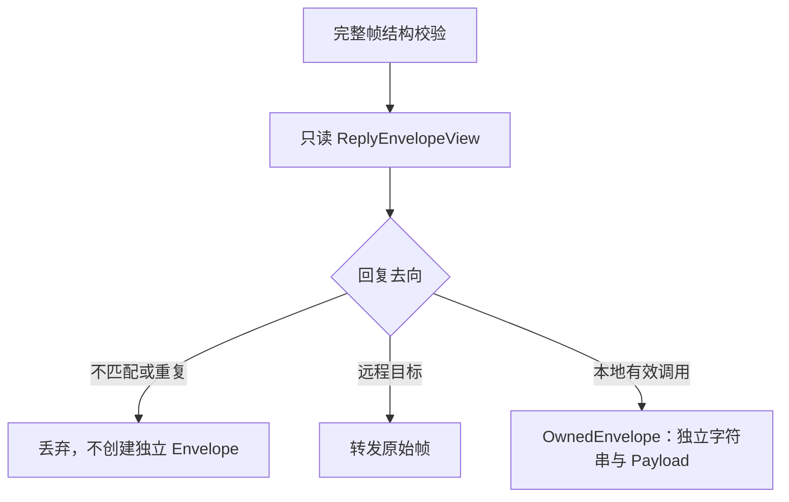
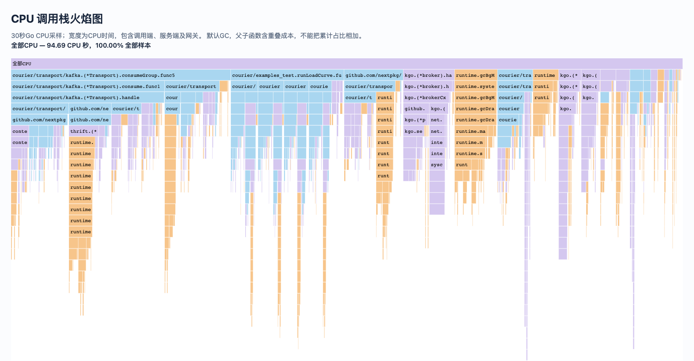
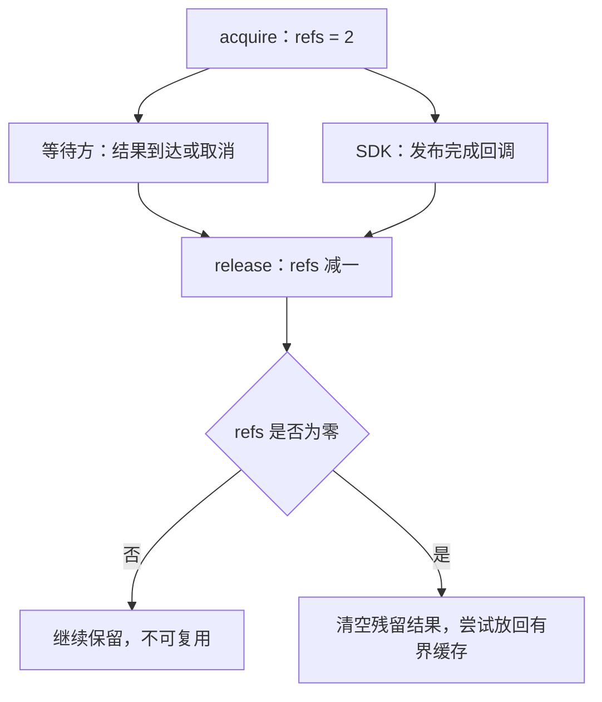
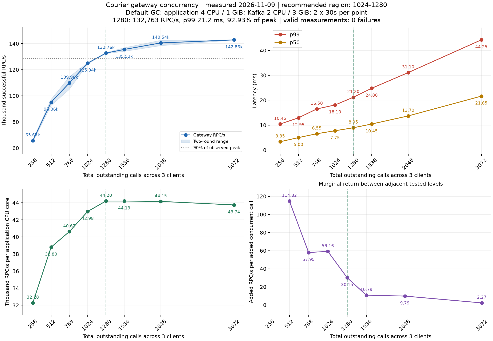
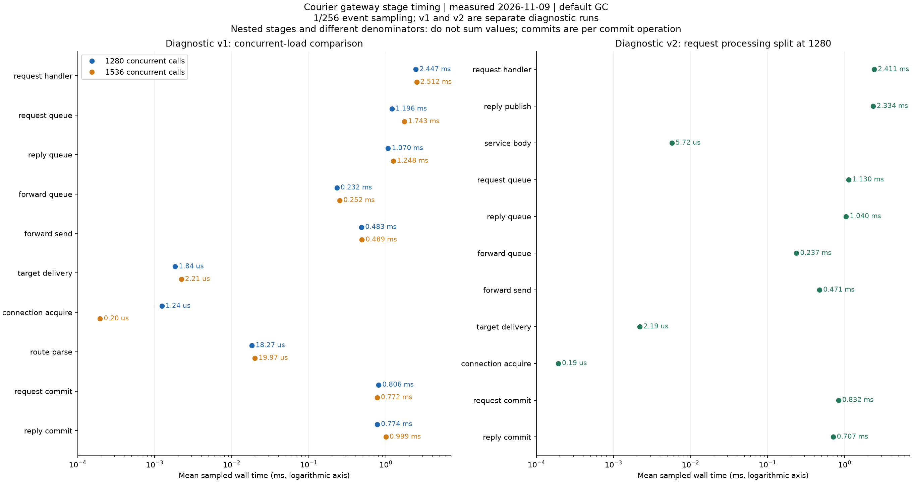

# 从 2.9 万到 13.8 万 RPC/s：Kafka 回复网关的性能优化记录

Courier 用 Kafka 传递 RPC 请求和回复。客户端将请求写入 Kafka，服务端处理后，再把回复写入指定的回复分区。在直读模式下，客户端直接读取回复分区，从中找出自己的消息；多个客户端读取同一分区时，也会重复读取彼此的回复。

回复网关让同一个消费组分工读取这些消息，再送回发起请求的进程：Instance 用于识别目标实例，Session 用于查找实例内的收件箱，请求 ID 则用于匹配具体调用。目标在本地时直接交付，在其他实例时通过网络转发。这样减少了 Kafka 上的重复读取，却增加了路由和转发开销。这轮优化要解决的，就是这部分开销。

本文的性能曲线从首次优化后的约 2.9 万 RPC/s 开始，后期代表结果达到约 13.8 万 RPC/s。首次优化本身的基线约为 1.04 万 RPC/s，详见阶段 01。各阶段的负载和环境有过变化，首尾数字不能用来计算受控的累计加速比。下面既记录吞吐上升的改动，也记录吞吐持平、只减少流量或分配的改动。

下面按实施顺序展开 16 个阶段，相邻的小改动合并介绍。几个关键问题贯穿其中：worker 为什么迟迟不能处理下一条消息，合批如何减少每条回复的转发成本，以及异步调用结束前，哪些数据可以复用。

每一阶段都配有流程图、代码或配置对照。标注“源码节选”的代码取自保留实现；标注“示意”的片段只突出决策和数据流，省略锁、错误处理等细节，不是可直接运行的示例。Mermaid 图可在 GitHub 等支持它的 Markdown 阅读器中展开。

## 先看全貌，以及这条曲线能说明什么



图中纵轴是每秒成功完成的 RPC 数，包含请求、业务处理和回复；横轴是优化顺序。它是一份历史记录，不能用相邻节点的差值计算某一项改动的严格收益。

主测量在单机 Linux ARM64 容器内进行，应用合计 4 CPU、1 GiB，Broker 为 2 CPU，内存从早期 2 GiB 调整到后期 3 GiB。转发使用 loopback 网络。早期有 12 个独立客户端进程、单方法、768 并发的测量，随后转为同一应用进程内三个客户端、两个服务各两个实例、四方法混合调用，常用总并发为 1536。早期部分轮次开启了诊断采样，后期将采样与正式计时分开。

因此，曲线展示的是工程演进中的代表结果。判断一个改动是否值得保留，主要看同轮基线/候选对照；较小的收益还要结合分配、流量、尾延迟和正确性。直读、调整 GC 参数的实验和持续负载结果没有混进主线。

## 01　回复即发：先把 worker 从等攒批中释放出来

最初，网关的吞吐约为 1.04 万 RPC/s。服务端配置了 128 个处理 worker，分段计时显示，每个请求平均占用 worker 接近 12 ms，约 124 个 worker 持续处于处理或等待状态。按 `128 ÷ 0.012` 估算，每秒能处理约 1.07 万个请求，与实测接近。要提高吞吐，首先需要查清这 12 ms 花在了哪里。

worker 执行业务逻辑后，还要等待回复发布完成，才能处理下一个请求。回复 producer 默认有 10 ms 的 linger，用于积累消息、合并发送；这段等待也占用了处理 worker。因此，我们先将**回复侧** linger 设为零，检查减少攒批等待能否提高吞吐。两轮测试分别达到 2.84 万和 2.95 万 RPC/s，均值约 **2.89 万 RPC/s**。

请求侧仍可保留批处理。将两端 linger 一起归零，在当时的配置下反而没有只改回复侧好。取消攒批等待也没有取消 Broker 确认，worker 仍要等真实发布结果。

**关键变化：删掉攒批等待，保留发布确认。**



## 02　Thrift/TCP：降低逐条转发的传输成本

回复发布不再等待攒批后，接下来检查逐条转发的成本。HTTP 路径每次都要构造请求、处理头部、读取正文；转发的数据本身却已经是二进制消息。Thrift Binary over framed TCP 可以省去一部分 HTTP 包装，因此值得做一次替换对照。两种路径都复用长连接，并保留路由校验、逐条状态和取消语义，避免把连接复用的收益算到协议替换上。

这一阶段已切换到三个客户端、混合业务的负载。同轮可比较的结果是 HTTP 中位数 **35776 RPC/s**、Thrift 中位数 **42431 RPC/s**，约提升 18.6%，单位成功调用的应用 CPU 也下降了。

协议替换缓解了一部分成本，但当时直读约为 9 万。剩余差距仍然很大，继续换传输框架并没有充分依据，需要往调用链里找。

**转发路径对照（示意）：长连接仍复用，减少协议包装。**



## 03　预算快判与二进制合批：少做临时工作，摊薄每次转发

请求必须给错误回复留出空间。当时的检查每次都会构造并序列化一份假想错误回复，再判断它能不能装下。对于远离帧上限的小请求，这是一笔反复支付的分配成本。

这里真正需要回答的是“错误回复能否装进帧”，不一定要先生成那份回复。只要一个保守的大小上界已经低于帧上限，就可以直接通过；接近边界时，再精确序列化。这样省去常规小请求上的临时对象和编码，消息大小和错误回复预算的约束仍然保留。

转发还有一项可以分摊的成本：每发一条回复，就要支付一次网络请求和收发处理的开销。为此，把发往同一目标的已就绪回复合成一批。第一条不等定时器，也不强制凑满；发送期间到来的回复形成下一批。这样既利用了繁忙时队列中的消息，也避免为了合批重新引入阶段 01 的等待。批体用数量和长度前缀承载原始字节，避免再次用 JSON/base64 包装。

接收端逐条返回处理状态。网关按分区记录消息的完成情况，只提交处理成功的连续前缀。这里的转发状态、producer 发布确认和 Kafka offset 提交是不同步骤；收到转发状态也不等于业务调用方已经持久化处理了结果。

最终构建中，单条转发为 **48715 RPC/s**，最多 16 条一批为 **66267 RPC/s**。这次批次密度足够高，摊薄了网络请求和临时对象成本。更早的 HTTP 合批尝试虽然减少了请求数，却受其他等待限制，没有获得同样的吞吐收益。

**预算判断（示意）：大多数小请求不必先造一份错误回复。**

```go
if conservativeErrorReplyBound(request) <= frameLimit {
    return nil // 保守上界已能证明装得下
}
return checkByExactEncoding(request, frameLimit) // 边界情况精确编码
```

**合批调度（示意）：发送已有消息，不用定时器等下一条。**


## 04　缓冲池与解析复用：把重复分配和重复解码拿掉

Thrift 编解码反复创建临时缓冲区、协议对象和配置结构。这些对象完成一次同步编码后，就可以清空并用于下一次操作，没有必要每次重新分配。池化时，每次使用前重新设置大小限制，用完归还；超过容量阈值的大缓冲直接交给 GC，避免偶发大报文长期占住空间。

复用的前提是分清所有权。返回给异步调用方的数据仍要独立持有，不能把马上回池的缓冲直接交出去。可以省掉的是同步处理期间的中间副本。

另一个重复点位于适配器和核心之间：Kafka 适配器已经解码过请求，核心又解析了一遍同样的 Envelope。增加接收已解析信封的可选接口后，核心继续检查自己的帧上限、服务、期限和业务消息，只复用解析结果。原来的字节接口仍可使用。

经过池化和接收侧解析复用，这一阶段代表结果约为 **7.27 万 RPC/s**。这些改动的范围不同，不能把跨轮数字的差额全部算到某一个池上。

**源码节选：同步编码可以借用池，返回值必须独立持有。**

```go
func marshalForwardRoute(f forwardRoute) ([]byte, error) {
    c := getRouteCodec()
    defer putRouteCodec(c)
    b, err := encodeBinaryRoute(c, f)
    if err != nil {
        return nil, err
    }
    return bytes.Clone(b), nil
}
```

这里保留最后一次 `Clone`，避免回池覆盖返回值。解析复用则是在适配器完成解码后，直接把已解析信封交给核心校验，跳过第二次解码。

## 05　二进制信封：业务已经是二进制，外层也可以更直接

业务参数本来就是 Thrift 二进制，外层 Envelope 和路由元数据却仍经过 JSON。Payload 要先转成 base64，接收端再还原字节；业务参数没有变化，却多了一次表示转换。因此，这一步尝试直接用二进制格式承载信封和路由字段，减少外层包装的编码与复制。

这一阶段引入二进制信封与路由编码，同时整理发送和交付路径：先确定回复分区，再编码一次；在同一进程内复用已验证的解析结果，跨进程边界继续校验。消息离开临时缓冲前，仍要取得正确的所有权。

同程序、同资源的 ABBA 对照中，JSON 路径均值 **71538 RPC/s**，二进制路径 **79940 RPC/s**，约提升 11.7%。这一节点仍处在双格式代码共存的阶段，后面才将实现收敛成唯一二进制格式。

**数据流对照（示意）：不再把二进制业务数据包进 JSON。**



## 06　并发与批次联合调优：worker 多也要付成本

发布、服务消费和回复消费的 worker 都曾配置为 512。这些 worker 除了执行请求，也需要栈空间和调度。增加 worker 能容纳更多等待中的任务，却不保证应用每秒完成更多调用。因此，这一步同时检查两个配置：是否需要这么多 worker，以及每次转发能否承载更多消息。

在保留二进制格式和复用机制的基础上，把这些 worker 调为 128，核心处理并发也设为 128，同时把就绪批上限从 16 调到 32。它是一组联合配置，不能把收益单独归于“减少 worker”或“增大 batch”。

同轮高并发对照从 **78196** 升到 **93017 RPC/s**，约提升 19%；单位 RPC 的 CPU 成本和应用峰值内存也下降。低并发没有同等幅度的改善，因此这些值作为该负载的显式配置保留，没有改成全局默认值。

**同轮配置对照：同时减少调度竞争、提高批次上限。**

| 配置 | 基线 | 候选 |
| --- | ---: | ---: |
| 发布 / 服务 / 回复 worker（各组） | 512 | 128 |
| 就绪批上限 | 16 | 32 |

这些是压测的联合参数，不是给所有业务推荐的新默认值。

## 07　减少复制：路由、deadline 和转发包装逐层收紧

继续检查调用链，会发现有些工作只是因为沿用了原有接口而重复执行：同步本地交付仍新建 deadline，Thrift 转发仍绕经 HTTP 包装，中继只读取路由头却先复制了一份。检查的依据是这一步是否真的需要独立的数据或上下文，而不是统一删除所有复制。

路由编码复用临时缓冲，并减少重复编码；本地同步交付沿用父 context，不再为每条回复都创建新的 deadline；Thrift 批发送直接调用内部转发入口，省掉 HTTP Request/Response 包装和中间读取。随后，中继直接借用 Kafka record 中的路由头，出队后清空旧队列槽，避免继续持有已发送消息。

这些改动分别做过对照，曲线合并展示这一组工作的结果。最后一次路由头借用对照中，基线 **96538 RPC/s**，候选 **101849 RPC/s**。

借用字节必须有明确期限：只读、限制切片容量，且原始帧在转发结束前不能回收。如果以后启用 fetch 缓冲回收，还需要重新检查整条异步所有权链，不能因为一次省复制有效，就把所有字符串和 Payload 都改成借用。

**源码节选：借用路由头时，把容量也限制在当前长度。**

```go
for _, h := range headers {
    if h.Key == routeHeader {
        return h.Value[:len(h.Value):len(h.Value)], true
    }
}
```

三下标切片不复制数据，也不使数据只读；它只防止 `append` 覆盖后续存储。只读约定和原始帧的存活期仍由调用链保证。

## 08　移除 HMAC：性能收益来自部署边界的明确选择

原来的路由头和转发消息都有应用层 HMAC。这项开销能否删除，首先取决于部署是否需要用它验证消息来源，不能只看跑分。确定部署对象是可信企业内部服务后，才删除签名计算、相关字段以及编码和验证分支，同时保留实例、session、请求 ID、分区、期限和消息匹配检查。

同轮网关均值从 **99869** 升到 **118806 RPC/s**，约提升 19%。收益包含摘要计算、签名字段及相关分配的共同减少，不能只归给某一个 HMAC 函数。

这项改动有明确的安全前提：Kafka 写入方、网关端点和服务都属于可信部署。关联字段能检查消息是否对应，不能代替身份认证。跨租户或不可信网络不能照搬这一选择；HTTP 路径仍可配置 TLS，本文测量的 Thrift TCP 是内网明文转发。

**校验边界对照：移除的是签名工作，其余关联检查继续执行。**

| 检查 / 成本 | 原路径 | 可信内网路径 |
| --- | --- | --- |
| HMAC 生成、编码、验证 | 每条执行 | 移除 |
| Instance / Session / ID 匹配 | 保留 | 保留 |
| 分区、期限、消息对应关系 | 保留 | 保留 |
| 不可信写入方的身份认证 | 需要部署保障 | 不能由关联字段替代 |

## 09　去掉连接轮询：已收齐的内存帧不需要再检查 socket

Courier 把完整请求帧收齐后交给 Thrift 处理器。当时的官方生成处理器仍会按原生网络服务的方式，为每次调用准备连接存活检查，产生额外 goroutine、ticker 和 context。对于已经在内存中的请求，这些检查没有提供对应的网络存活信息。

生成器因此派生出供 Courier 使用的处理器，保留官方参数、结果和异常处理，只去掉连接检查分支。原生 Thrift 处理器仍可用于网络服务，进程全局的连接检查设置没有被修改。业务 context 的取消和期限也继续传递。

同轮均值从 **118178** 升到 **125341 RPC/s**，约提升 6.1%；分配采样中不再出现对应的 ticker 和额外 context 路径。

**处理器差异（示意）：输入已经是一份完整内存帧。**

```diff
  解码官方 Args
- 为本次调用创建连接检查 goroutine / ticker
  使用业务 context 调用 handler
- 停止本次连接检查
  编码官方 Result / Exception
```

这里只描述 Courier 派生处理器的变化，未更改官方网络处理器或全局连接检查开关。

## 10　统一二进制：收敛已经做出选择的协议分支

二进制模式有效以后，运行代码还保留着 JSON 与二进制两套路径。最终将信封、路由和批转发统一为 v1 二进制格式，移除旧解析分支和格式开关。JSON 仍可用于统计输出，不再进入消息编码路径。

这个阶段还保留了前一轮批编码缓冲复用。采用唯一二进制格式后，路由对象不再因 JSON 反射分支逃逸；同轮吞吐均值从 **127198** 升到 **130743 RPC/s**。基线本来就在跑二进制模式，因此这项收益不同于前面“JSON 改二进制”的对照。

格式收敛也明确了兼容边界：旧 JSON 消息不再支持，通信两端需要使用匹配版本，不能把它当成无感升级。

**分支收敛（示意）：从运行时选格式，变成唯一受检入口。**

```diff
- 判断格式 → JSON 解码 / 二进制解码
+ 校验 v1 二进制前缀 → 二进制解码
```

与阶段 05 的区别在于：基线已选择二进制，本次移除的是仍留在代码中的另一条格式分支。

## 11　路由缓存：复用稳定身份，逐条处理变化字段

Endpoint、Instance、Session 和配置中的 Topic 在大量请求间保持稳定，ID 和期限却每次都变。把它们分开处理，才能减少重复工作而不串消息。

路由器为稳定身份维护最多 64 项的不可变快照。规范字段顺序走受检游标，命中时复用已验证的字符串；字段重排或扩展仍交给完整解码器。请求 ID、分区和期限逐条检查，需要进入去重表的 ID 继续独立保存。

同轮均值从 **130690** 升到 **133451 RPC/s**，约提升 2.1%。暖缓存微基准的分配从每次 216B、6 次降到 16B、1 次，但整体吞吐的增幅远小于局部函数的加速。高身份变更率下，缓存命中率也会不同。

**字段分工：缓存稳定身份，不缓存“这一次调用”。**

| 字段 | 处理方式 |
| --- | --- |
| Endpoint / Instance / Session / Topic | 最多 64 项不可变身份快照，命中时复用 |
| ID / Partition / Expires | 每条读取并检查，不因身份命中而跳过 |
| 非规范顺序、扩展字段 | 回退完整解码 |

去重表需要长期保存的 ID 独立持有，不能引用下一次 fetch 可能复用的字节。

## 12　双批并行：允许重叠，但保住批次密度

每个目标只有一个发送者时，后一批会等待前一批往返。直接增加发送协程又可能把批次切碎，更多并发反而带来更多请求。

保留的做法是每目标最多两批在飞。没有发送任务时，少量已就绪回复立即发出；已有一批在飞时，后续队列达到批大小才启动第二批。协调者统一出队，后批可以先完成，但 Kafka 仍只能提交连续完成的 offset。

这两个发送条件分别处理空闲和繁忙的情况：没有在途批次时，等待凑批会直接增加回复延迟；已有批次在途时，等待后续消息可以保留批次密度。如果前一批先完成，剩余消息也可以立即发送，不必一直等到队列填满。

同轮串行与双批对照为 **134444 → 136560 RPC/s**，约提升 1.6%，每批消息数基本保持。这个版本保留为显式选项。此前另一种“两批在途”尝试没有稳定的全负载收益，并未沿用；相同的并发上限不代表相同的调度实现。

**调度条件（示意）：有空位还不够，第二批也要有足够的就绪消息。**

```go
switch {
case inFlight == 2:
    waitForCompletion()
case len(queue) == 0:
    waitForWorkOrCompletion()
case inFlight > 0 && len(queue) < batchSize:
    waitForFullBatchOrCompletion()
default:
    sendReadyBatch() // 另受帧大小、过期和取消约束
}
```

例如，同一分区中先拉取 offset 40，再拉取 41，即使 41 先完成，也不能越过尚未完成或失败的 40 提交。窗口按各分区实际拉取记录的顺序推进成功前缀，不要求 offset 整数逐个连续；不同分区分别推进。窗口可推进后，仍需向 Broker 提交相应位置，不能把内存中的完成通知当成提交已经成功。

## 13　回复视图：先判断要不要接收，再构造完整对象

完整解码会创建字符串和 Payload 副本。但直读客户端可能读到别人的回复，网关中继也可能只需要把消息送到另一个进程。提前把所有字段物化成独立对象，会在这些路径上做无用工作。

回复视图先检查整个信封的结构，再用只读字节切片完成匹配。确实要交付给本地调用方时，才构造独立拥有数据的 Envelope；远程转发保留原始帧。乱序或扩展格式仍有完整解码回退，结构校验没有省掉。

网关同轮均值从 **135527** 升到 **137622 RPC/s**，约提升 1.55%。直读也受益，而且幅度更大，约提升 5.2%。公共路径上的优化会同时移动两条基准线，不能把直读的历史值当作固定目标。

**规范编码快路径：先做匹配，只有本地接收时才物化。**



## 14　精简转发：吞吐持平，流量仍值得省

Kafka 路由头里的一些字段已经存在于回复信封中，转发批次又携带一遍，目标端还要重复读取和对照。

精简后的条目只保留进程 Instance、期限 Expires 和原始信封 Data。Endpoint 由目标连接确定，其余关联字段从信封视图取得；中继入队前仍验证完整路由，目标端继续检查实例、期限、分区、收件箱和去重。

这一轮基线与候选约为 **137385 / 137379 RPC/s**，吞吐基本持平。loopback 单方向收发速率约减少 33%，因此保留了这项改动。曲线上的 **13.74 万**记录的是吞吐平台中的一次流量成本改善。

**源码节选：批转发条目只携带三个字段。**

```go
type batchMessage struct {
    Instance string
    Expires  int64
    Data     []byte
}
```

`Data` 已包含信封中的 ID、Session、Topic 等信息，接收端从视图检查它们；没有把删掉的重复元数据变成跳过校验的理由。

## 15　完成通知复用：等待方退出，不代表回调也结束了

吞吐接近 14 万时，分配和 GC 仍占据可见成本。该阶段一次默认 GC 采样中，分配/GC 相关调用栈的去重并集约占 30.3% CPU。下面的火焰图包含客户端、服务端和网关，它提示了减少分配的空间，但不能据此承诺等比例的吞吐提升。



*这张图来自发布完成槽复用前的一次 30 秒采样，总计 94.69 核秒。橙色为 Go runtime，蓝色为 Courier，紫色为依赖或系统调用；父子调用的累计占比有重叠，不能相加。*

发布路径每次都创建完成通知，用来接收 SDK 回调的结果。看起来只需在调用结束后把对象放回池，但“调用结束”在这里有两个不同时间：等待方可能已经超时返回，SDK 回调却还没有执行。如果超时后立即回池，下一次调用取走同一个对象，迟到回调就会把上一次发布的结果写给新的等待方。

因此，回收条件必须同时覆盖等待方和回调。两方各持一个引用，各自结束时释放；引用数归零后，才能清空残余结果并归还到有界缓存。公开 Future 不回池，缓存中的对象按需创建。

这轮平均每成功 RPC 的分配约减少 2.1%，但短测 **138029 / 138028 RPC/s**，吞吐基本持平。它是一次分配成本优化，不能把火焰图中的热点占比直接兑换成吞吐涨幅。

**双引用生命周期：超时只释放等待方，回调仍拥有对象。**



等待先超时时，引用数从 2 降到 1；迟到回调写入结果并释放最后一个引用后，才能清理并复用。

## 16　转发项复用：沿用同样的所有权约束

转发条目和它的完成通知也会反复创建。沿用双引用方法，等待方和批发送方各持一份；双方结束后，清除消息、context 和残留状态，再归还缓存。等待方取消不会提前释放发送方仍在使用的数据。

环境稳定后的同轮结果是基线 **135330**、候选 **137755 RPC/s**，约提升 1.8%。p99 同时从 24.0 升到 24.8 ms，并非所有指标都改善。独立的 180 秒持续轮为 **141499 RPC/s**、零调用失败；持续轮不放进短测曲线，也不拿来与短测基线算涨幅。

前一阶段曲线是 13.80 万，这一阶段是 13.78 万，差别来自不同轮次的观测。图保留了这些小波动，采用与否依据的是同轮对照和具体成本变化。

**源码节选：双方都释放后，才清理条目持有的输入。**

```go
if item.refs.Add(-1) != 0 {
    return
}
select {
case <-item.done: // 取消可能留下未读取的结果
default:
}
item.message = batchMessage{}
item.ctx = nil
```

之后才尝试归还有界缓存；缓存满则让 GC 回收。与上一阶段的区别是另一个引用属于批发送方，必须等网络发送结束，不能只等调用方退出。

## 并发取舍

代码优化后，继续增加并发还能提高吞吐，但调用也可能只是在队列里等得更久。要选择运行参数，必须同时看吞吐增加了多少、尾延迟增加了多少。为此，对同一保留版做了 256 到 3072 的八档扫描，每档两次有效测量。



在这组数据里，总并发 1280 达到 **132763 RPC/s**、p99 **21.2 ms**，约为峰值的 93%。升至 1536，吞吐只增加约 2.1%，p99 增加约 17%；升至 3072，吞吐增加约 7.6%，p99 却增加约 109%。更重视延迟时，1024 是另一处可考虑的取舍点。

这里的并发是三个客户端合计，不是每个 Client 都设 1280，也不是库的 MaxInFlight 默认值。一次后续对照在 1280 下测得保留版约 13.49 万，性能轴将它另列，因为它不属于前面 1536 并发的代码优化序列。

## 分段耗时

为了理解平台期，又在低干扰条件下做了分段采样。左图比较 1280 和 1536，右图细分 1280 下的请求处理；它们是两版独立诊断构建。



细分采样中，请求处理均值约 2.41 ms，其中回复发布至 SDK 完成约 2.33 ms，业务 handler 只有约 6 µs。请求/回复 worker 排队约 1.13/1.04 ms；转发排队约 0.237 ms，批发送往返约 0.471 ms，目标交付仅数微秒。阶段有嵌套、分母也不同，不能把这些均值直接求和当作一次 RPC 的总延迟。

其中，回复 worker 的排队和转发等待与网关路径直接相关，因而提出了一个假设：如果 worker 将回复放入转发队列后就能继续消费，是否可以减少等待、缩小网关与直读的差距？回复发布等待则是两种模式共有的成本，不能都算作网关额外开销。

候选实现让回复消费 worker 在入队后继续工作，由转发完成回调推进完成窗口，并保留窗口上限、确认和 offset 提交语义。但同轮网关吞吐从 **134860** 降到 **131186 RPC/s**，p99 从 20.35 升到 21.05 ms，直读基本持平，因此没有采用。

这个结果没有支持预期：至少这版实现没有把解除等待转化为吞吐收益。现有对照也不足以确定下降来自哪一项调度或同步开销。分段计时帮助我们选择了一个值得验证的方向，最终是否保留，仍由完整调用的结果决定。

## 这轮优化留下的工作方法

回看这些改动，首先要区分计算耗时和占用时间。阶段 01 的 worker 迟迟不能接下一条请求，是因为它还在等回复发布。用 worker 数量和平均占用时间估算容量，再与吞吐对照，比直接增加并发更容易找到该检查的位置。但后来的解耦实验也说明，发现等待只够提出假设，不能据此断定解除等待一定有效。

其次，局部成本下降与整体吞吐上升是两回事。路由缓存显著减少了局部函数的分配，完整 RPC 只提高约 2.1%；完成通知复用减少分配后，吞吐基本持平。精简转发则在吞吐不变时减少了流量。是否保留这些改动，需要分别说明改善了哪个指标、付出了什么代价，而不是都用性能曲线上的涨幅解释。

最后，异步路径中的复制与回收要一起考虑。路由头可以借用，是因为转发结束前原始数据仍然有效；完成通知不能在调用方超时时立即回池，是因为回调仍会访问它。先列出所有使用者及其结束时间，才能判断哪份副本可以删除、哪个对象可以复用。

这些判断仍需完整调用对照。局部微基准用来确认复制或分配是否减少，完整 RPC 测量用来检查吞吐、尾延迟、CPU 和失败情况。共享宿主的 CPU 竞争及诊断采样本身也会影响结果，需要分别核对；不能仅因某轮结果较低就将其排除。

保留版做过 race、协议边界、迟到回调、路由扩容和重启等验证。公共取消合约还记录过基线与候选共有的 Broker 冷启动协调器未就绪失败，因此本文不把若干轮零失败解读为全量服务合约或生产可靠性保证。

最终留下的是一组适合该负载的实现和并发取舍。迁移到更大的消息、真实跨主机网络或不同业务耗时时，需要重新测量，沿着相同的方法寻找新的拐点。

## 测量版本与阅读说明

性能轴汇总早期多个快照；并发与分段耗时图对应后期保留版，核心源码内容可在 [36f1ed8](https://github.com/nextpkg/courier/commit/36f1ed8af0eae6906f8e3ec7ee746bd749336580) 查阅。后续接口和文档清理没有重新跑吞吐，因此这些数字不能直接归于任意新提交。

后期混合负载包含 `Orders.Get`、单元素 `Orders.List`、`Inventory.Reserve` 和 `Inventory.Count`。处理器直接在内存中构造返回值，不访问数据库或外部服务；`Get` 的延迟参数设为零。请求主要传递 ID，回复为包含 ID、来源和少量整数的结构体、单元素列表或整数。这组测量主要用于观察 RPC 传输与调度开销，不能代表带数据库访问或大报文的业务。四种方法按压测 worker 分组执行，不保证成功调用数严格各占四分之一。调用与校验方式见 [压测入口](https://github.com/nextpkg/courier/blob/02bec208c43f6a5749133bdbbbc79bfdae8444d3/examples/kafka_load_test.go)，消息字节数会随 ID 等字段变化，本文未给出精确大小分布。

文中的“同轮对照”指同一组实验中的基线和候选比较，不是与曲线前一个节点相减。各节保留原实验的统计方式：均值、中位数或历史代表结果分别注明；ABBA 对照按基线、候选、候选、基线的顺序交替运行。

后期环境为 Go 1.27.3、Linux ARM64、默认 Go GC；应用 4 CPU/1 GiB、GOMAXPROCS=4，Kafka 4.4.0 为 2 CPU/3 GiB。发布、服务、回复 worker 均为 128，window 1024，batch 32，每目标两批在飞。正式对照常用独立 Broker、独立进程预热 5 秒后测量 30 秒；p99 为轮次百分位均值，不是合并请求后的百分位。分段诊断每 256 个事件选一次样本，记录墙钟时间。

源码入口可从 [二进制信封与视图](https://github.com/nextpkg/courier/blob/36f1ed8af0eae6906f8e3ec7ee746bd749336580/envelope_view.go)、[回复路由](https://github.com/nextpkg/courier/blob/36f1ed8af0eae6906f8e3ec7ee746bd749336580/transport/kafka/router.go)、[发布完成槽](https://github.com/nextpkg/courier/blob/36f1ed8af0eae6906f8e3ec7ee746bd749336580/transport/kafka/publish_completion.go)和 [转发项生命周期](https://github.com/nextpkg/courier/blob/36f1ed8af0eae6906f8e3ec7ee746bd749336580/transport/kafka/forward_item_pool.go)阅读。
