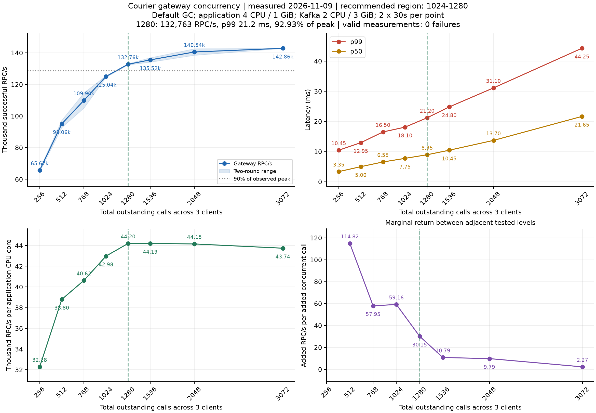
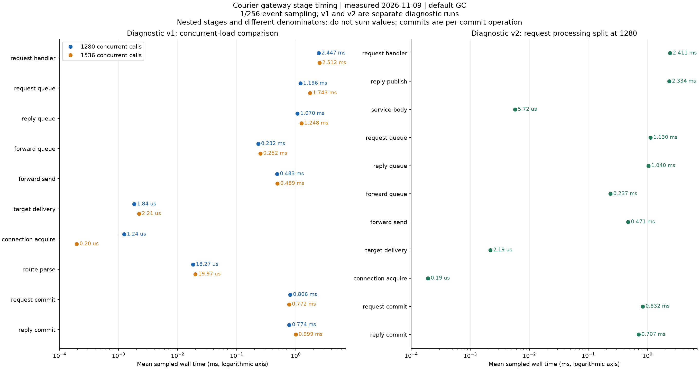

# Kafka 网关性能图表

测量日期：2026-11-09。源码内容对应 [36f1ed8](https://github.com/nextpkg/courier/commit/36f1ed8af0eae6906f8e3ec7ee746bd749336580)；后续接口和文档整理未重新测量吞吐。这些图是该历史版本的测量结果，不是任意当前提交的性能保证。

测试二进制 SHA-256：`820cb4a604e753388494716d951a28c207790b4bfbc191f7ef99a82a42bc3cad`。

## 条件与负载

Linux ARM64、Go 1.27.3、默认 GC；应用 4 CPU / 1 GiB、GOMAXPROCS=4，Kafka 4.4.0 为 2 CPU / 3 GiB。三个客户端、两个服务各两个副本共用应用容器，四种混合调用，转发使用 loopback Thrift TCP。发布/服务/回复 worker 均为 128，window 1024，batch 32，每目标两批在飞。

并发是三个客户端的**总在途调用数**。每档两次有效的 30 秒闭环测量，每轮新 Broker，独立进程预热 5 秒；p99 为轮次百分位均值。两次明显受外部 CPU 竞争影响的测量已剔除并补测，所有有效轮次零失败。它们不是持续负载或固定到达速率过载测试。

## 并发取舍

拐点区间约 1024–1280。1280 达到峰值约 93%，升至 1536 仅增吞吐约 2.1%，p99 却增加约 17%。更重视延迟可选 1024；90% 峰值线是比较标尺，不是业务 SLO。阴影为两轮范围，边际收益为相邻档新增 RPC/s 除以新增并发。

## 分段耗时

左图的 v1 是 1280/1536 并发对照，右图的 v2 单独细分业务调用与回复发布。采样每 256 个事件选一次，数据是墙钟时间，不是 CPU 时间；嵌套阶段和不同分母不能求和为端到端延迟，commit 按每次操作统计。

请求处理的主要等待在回复发布至 SDK 完成，业务 handler 本身仅数微秒。队列计时不含 SDK fetch 缓冲；发布包含 SDK 缓冲、确认和调度。低干扰 v2 开关采样对照的吞吐差约 −0.85%，只有一对结果，不代表统计显著性。

后续异步解耦实验没有提高吞吐，因此未进入保留实现。当前配置与验证入口分别见 [Kafka 手册](../../KAFKA.md)和 [测试说明](../../TESTING.md)。
